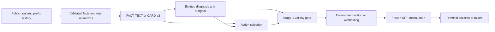
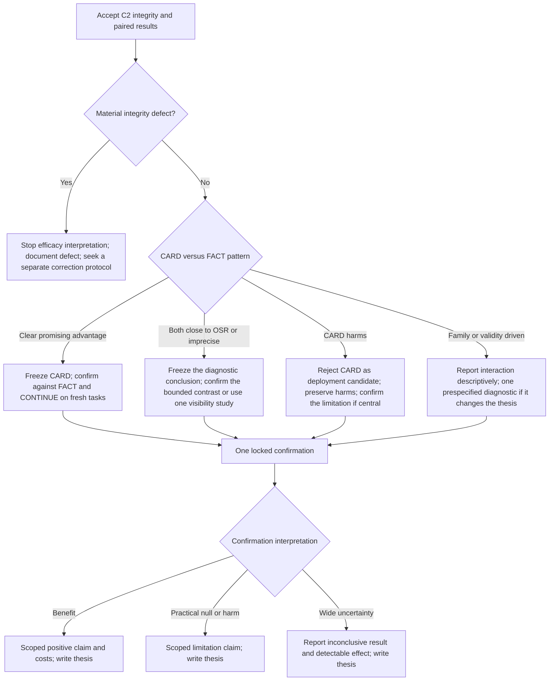

# Research Steering Review

## 1. Executive assessment

The strongest thesis is a controlled empirical study of **when public task-progress information becomes useful action, and where that conversion fails in bounded recovery**. The evidence does not yet justify a thesis centered on an effective progress-aware method or a learned intervention selector. A coherent master's thesis remains achievable with the current evidence, completion of the frozen information/representation comparison, and one prospectively locked confirmation study. A positive CARD-v2 result is not a graduation requirement.

Three findings are established within their stated populations. First, expert action imitation produced a substantially more capable Qwen3-8B actor under a matched interface, although pick-two competence remains weak. Second, exactly replayed recovery branches contain both rescues and harms; changed actions and fewer loops often fail to translate into terminal success. Third, semantic validation exposed missing extractable facts in the original progress cards. Corrected FACT-TEXT changes many emitted diagnoses and subgoals, but its terminal advantage over OSR is only one net success on 60 reused development prefixes. These are empirical and measurement contributions, not proof of a general recovery mechanism. [E1–E9](#internal-evidence-register)

**Novelty risk is HIGH for broad method claims and MODERATE for the narrower audit contribution.** State tracking, progress-aware reasoning, runtime intervention, paired counterfactual branching, and rescue/harm accounting all have close precedents. In particular, the original selector framing now overlaps with COTA and *Calibration Is Not Control*. StateAct also includes state-verification and format ablations, so even “we audit state” or “we compare formats” is insufficient novelty by itself. The differentiated possibility is the combination of public-evidence validation, identical-fact treatment construction, fixed-prefix bounded interventions, execution-validity accounting, and downstream outcome analysis. This combination is a contribution direction, not an established first-in-literature claim. [COTA](https://arxiv.org/html/2608.21027v1), [Calibration Is Not Control](https://arxiv.org/html/2606.21399v1), [StateAct](https://arxiv.org/html/2410.02810v3).

The next required scientific comparison is **R18-C2: frozen CARD-v2 versus accepted FACT-TEXT**. In this checkout, its treatment assets and contrast are frozen, but no dedicated R18-C2 runner, tests, result report, or execution acceptance is present. Implementation review must precede future inference. This review authorizes and performs no inference, environment execution, protocol changes, branch merges, or confirmation-set consumption.

The interim presentation can tell a defensible research story now. Its remaining preparation is a slide deck and rehearsal, not a positive experimental result. “Next Friday,” relative to the review date of 13 September 2026, is **18 September 2026**.

### Evidence authority and current status

The review snapshot is local branch `agent/codex-r18c2`, HEAD `b06b1fb`, whose preceding accepted results commit is `3a6b374ecf1628f59ae90805f850fe7e4ba71a6a`. `CURRENT_EXPERIMENT.md` names `codex/progress-aware-recovery` as the scientific branch and leaves the execution owner unassigned. This is a documentation/worktree distinction, not evidence that R18-C2 has executed. The same document contains placeholder hashes and an unselected status string; those are not acceptance records. [E10](#internal-evidence-register)

`PROJECT.md`, `PAPER_PROPOSAL.md`, `RESEARCH_QUESTIONS.md`, `RESEARCH_ROADMAP.md`, `EXPERIMENT_PLAN.md`, `IMPLEMENTATION_PHASES.md`, and `docs/PAPER.md` preserve earlier ambitions and milestones. They do not override later accepted results, and they do not authorize the selector, DPO, memory, or other prohibited additions. No dedicated interim abstract or presentation document was found among the repository's Markdown/text documents. The historical legacy 210-episode/28-success claim is not used: the provenance audit could not verify that corpus. [E0](#internal-evidence-register)

## 2. Current strongest thesis question

**For a frozen Qwen3-8B SFT actor in ALFWorld, how do validated public task-progress facts and their rendering affect one-step recovery actions, rescues, harms, and terminal success from identical trajectory prefixes?**

This question fits what the experiment can identify. It names the actor, intervention, population boundary, manipulated inputs, and terminal endpoint. The broader candidate—“Under what conditions can public task-progress information be converted into effective recovery actions and terminal task gains, and where does this conversion fail?”—is a good motivating question. It becomes too broad if presented as already answered across models, intervention durations, visibility schedules, or environments. “Conditions” must refer to tested conditions or clearly marked hypotheses.

| Alternative framing | Assessment | Decision |
|---|---|---|
| Predict when a small agent should spend extra reasoning | Scientifically meaningful, but no selector evidence here and substantial current overlap | Keep as historical motivation and future work |
| Progress-aware recovery improves small agents | Presupposes the unresolved result | Reject as the thesis claim |
| Why does reflection fail? | Too general; this project tests particular interfaces and bounded operators | Narrow to the measured conversion stages |
| Information versus representation in bounded recovery | Directly matches R18-B/C and supports a positive or negative result | Primary experimental framing |
| A semantic and causal audit of bounded recovery | Strongest present contribution; requires care about descriptive mechanisms | Primary thesis framing |
| Competence is necessary for recovery | Necessity was not identified | Supporting hypothesis only |

Suggested thesis title: **From Public Progress Facts to Recovery Actions: A Controlled Study of Small Language Agents in ALFWorld**.

## 3. Evidence accumulated so far

### Evidence labels

- **SUPPORTED:** a directly observed, scoped result or validated property; not automatically a population effect.
- **DIRECTIONAL ONLY:** a point estimate or descriptive mechanism is suggestive, but uncertainty or design prevents the stronger claim.
- **NOT SUPPORTED:** the asserted generalization or explanation exceeds the evidence.
- **FALSIFIED FOR THIS SPECIFIC PROTOCOL:** a preregistered operational target failed in this finite experiment. This label does not mean a population null was proved.
- **UNRESOLVED:** the relevant contrast or sufficiently precise confirmation is absent.

### Research trajectory and evidence table

| Hypothesis / question | Experiment and result | What it supports | What it falsifies or weakens | Remaining uncertainty / classification |
|---|---|---|---|---|
| Are weak-base failures just malformed actions? | Sprint 1.5 H4: 2/30 success, 1,410/1,410 valid selections; loops in 23/30 | Reliable grounding can coexist with weak task solving | Formatting-only explanation of these failures | **SUPPORTED** for H4; not a general Qwen capability estimate [E1] |
| Can a joint diagnosis/action call reliably enact its diagnosis? | Joint Sprint 2B: one positive case, diagnosis/action agreement 1/5 after its allowed revision; two-stage v1 then executed 0/10 because of output-contract failure | Interface and semantic fidelity are separate checks | Advancing either failed operator unchanged | **FALSIFIED FOR THIS SPECIFIC PROTOCOL** at their operational gates; all recovery is not falsified [E1–E2] |
| Can the repaired two-stage interface produce useful actions? | R2-v2: valid stages 10/10, beneficial/neutral/harmful 1/9/0 | A nonzero within-prefix recovery opportunity | “The operator can never rescue a task” | **SUPPORTED** existence; general benefit **UNRESOLVED** [E2] |
| Is weak-base recovery rich enough for selector development? | Sprint 2C: 120 prefixes from 79 episode groups; 2 beneficial, 115 neutral, 3 harmful; 37 loop reductions | Sparse value and genuine harm; behavioral change is a poor substitute for success | Frozen collection/selector opportunity gate | **FALSIFIED FOR THIS SPECIFIC PROTOCOL**; cause of sparsity not uniquely identified [E2] |
| Will prompting alone establish sufficient competence? | Factorial 1/24 to at most 4/24 with format failures; robust Phase B B1/B2/B3 = 1/36, 6/36, 5/36; demonstrations on a separate matched cohort B2/B2D = 1/36, 7/36 | Some prompt treatments help locally; procedural knowledge matters | Claim that grounding or one state block alone solved competence | **DIRECTIONAL ONLY** mechanisms; these are separate cohorts, not one progression curve [E3] |
| Does search/progress scaffolding solve the weak-base bottleneck? | B2D/B2DS: discovery 21/60→25/60, acquisition 17/60→23/60, success 9/60→10/60; predefined gates missed | Added state changes behavior with small net outcome gain | The specific B2DS advancement hypothesis | **FALSIFIED FOR THIS SPECIFIC PROTOCOL**; not evidence against every state representation [E3] |
| Can SFT-P0 establish competence? | Same 60 reserved TRAIN-development tasks/interface: base 3/60, SFT 48/60; 45 rescues, 0 losses. Separate valid_unseen evaluation: 49/60, Wilson 95% 70.08–89.44% | Strong matched competence gain and historical held-out actor performance | Claim that this policy remains uniformly weak | **SUPPORTED** overall; pick-two 1/10 development and 0/10 unseen contradict uniform family competence [E4] |
| Does a stronger actor make one-step recovery broadly effective? | SFT R4: 1/24 beneficial, 23 neutral, 0 harmful; rescue 1/13; 0/11 pick-two rescues | One-step intervention remains useful in a case with SFT follow-through | “SFT alone resolves recovery sparsity” | **SUPPORTED** sparsity; actor competence as causal moderator **UNRESOLVED** [E5] |
| Does persistence improve the same local recovery plan? | R10 OSR on 48 prefixes: CONTINUE 22, OSR 25 successes. R11 PBR-3: 23 successes; PBR versus OSR 1 win, 44 ties, 3 losses; exact two-sided p=.625 | Negative finite-sample net effect of this three-action treatment | Frozen persistence gate D; more of this frozen subgoal was not a successful next method | **FALSIFIED FOR THIS SPECIFIC PROTOCOL** gate; population harm only **DIRECTIONAL ONLY** [E6] |
| Why did PBR fail? | R12: 92 extra actions; only 7 branches with new public progress; 9 subgoals already satisfied after action 1; loops increased in 25/48 | Redundancy, stale-subgoal behavior, and handoff perturbation are plausible mechanisms | “Longer persistence failed only because no extra actions executed” | **DIRECTIONAL ONLY** causal explanation; no mediation experiment [E6] |
| Does public progress increase one-step recovery value? | R13 froze H-PROGRESS. R14 collected 180 fresh TRAIN tasks: 136 success; pick-two 3/30. R15 froze 60 prefixes from 60 distinct episodes; exact CONTINUE 29/60. R16 OSR 31/60, 4 rescues and 2 harms | Reproducible, enriched development comparison with family heterogeneity | Natural-population interpretation of the 60-prefix success rate | **SUPPORTED** protocol; hypothesis required R17 [E7] |
| Does PAR-v1 improve over OSR? | R17 PAR 33/60 versus OSR 31/60; W/T/L 3/56/1, p=.625; gate C; 18 pick-two failure prefixes retain 1/18 success in both | A +2 net development signal | Strong positive efficacy claim; original gate did not advance | **DIRECTIONAL ONLY**; reliable progress benefit **NOT SUPPORTED** [E8] |
| Were the v1 cards semantically adequate? | R18-A: 660 field rows; 27 unjustified unknowns in 19 prefixes; 19 target-type gaps. All four PAR/OSR terminal disagreements fell in those 19 prefixes | Concrete extractor coverage failures, distinguished from justified unknowns | Treating deterministic rendering as sufficient semantic validation | **SUPPORTED** gaps; gaps causing R17's result **UNRESOLVED** [E8] |
| Can corrected facts be isolated from rendering? | R18-B: 60 canonical fact objects; 353 exact, 259 justified unknown, 48 N/A fields; zero recorded remaining gaps; two semantically equivalent renderings | Validated construction under the public-evidence rubric | Claim that every missing location can be supplied from public history | **SUPPORTED** construction; efficacy **UNRESOLVED** at freeze [E9] |
| Do validated FACT-TEXT facts improve OSR? | R18-C1: 32/60 versus 31/60; W/T/L 3/55/2; +1.67 pp, exact p=1.0; 5/31 rescues and 2/29 harms versus CONTINUE | Text and action sensitivity, with small observed net terminal change | Claim of an established information benefit | **DIRECTIONAL ONLY** benefit; zero effect/equivalence also **NOT SUPPORTED** [E9] |
| Does CARD-v2 rendering outperform equivalent FACT-TEXT? | R18-C2 inputs frozen; no accepted outcomes in this checkout | A well-defined next contrast | Nothing about efficacy yet | **UNRESOLVED** [E10] |

### Numerical results that can safely share one table

The following rows all use the **same R15 development prefixes**, so comparisons within this table are paired. They are not benchmark episode success estimates.

| Treatment | Success / 60 | Rescue / 31 CONTINUE failures | Harm / 29 CONTINUE successes | Primary paired comparison |
|---|---:|---:|---:|---|
| CONTINUE | 29 | — | — | Frozen reference |
| OSR | 31 | 4 | 2 | vs CONTINUE: 4 wins / 2 losses |
| PAR-v1 | 33 | 5 | 1 | vs OSR: 3 wins / 1 loss; flawed v1 extraction |
| FACT-TEXT v2 | 32 | 5 | 2 | vs OSR: 3 wins / 2 losses |
| CARD-v2 | Pending | Pending | Pending | vs FACT-TEXT; do not fill from PAR-v1 |

Sources: [R15](PROGRESS_AWARE_RECOVERY_CONTINUE_R15.md), [R16](PROGRESS_AWARE_RECOVERY_OSR_R16.md), [R17](PROGRESS_AWARE_RECOVERY_PAR_R17.md), [R18-C1](PROGRESS_AWARE_RECOVERY_FACT_TEXT_R18_C1.md).

PAR-v1 is historical context in that table. Its 33/60 is not evidence that v1 is better than corrected facts: it is a different treatment, its extractor was audited after R17, and no planned v1-versus-v2 efficacy claim follows.

### The most informative FACT-TEXT decomposition

R18-C1 changed emitted diagnosis text in 54/60 and subgoal text in 51/60 pairs. Both treatments executed the same action in 34 pairs and different actions in 23; in 3 pairs OSR withheld recovery and FACT-TEXT executed. The 23 different-action pairs contain **2 wins, 19 ties, 2 losses**, net zero. The 3 execution-asymmetry pairs contain **1 win and 2 ties**, accounting for the total net +1. The winning asymmetry is `R15-F24`. These counts were checked against the accepted paired CSV. [E9]

This is a descriptive partition, not a causal mediation estimate. Restricting analysis to “both valid” conditions on a treatment-dependent variable. It is nevertheless essential context: the observed aggregate gain cannot be attributed exclusively to improved choice among valid recovery actions. Likewise, changing a diagnosis string does not establish more accurate reasoning or changed internal beliefs.

In pick-two failure prefixes, validated facts are count-aware in 18/18, instance-aware in 17/18, but location-aware in only 3/18. FACT-TEXT and OSR each solve 1/18. “Need one more object” is public progress information; it does not provide an undiscovered object's location or a learned search procedure. [E9]

### What must not be pooled

The weak-base 120 prefixes, SFT R4's 24 prefixes, R8's 48 prefixes, and R15's 60 prefixes differ in actor, source population, selection, and sometimes dependence structure. The weak-base corpus contains repeated prefixes within episodes. These are a scientific trajectory, not independent replications of one effect or a valid pooled meta-analysis. SFT's 49/60 unseen result is actor evaluation only; it is not recovery confirmation. Earlier valid_seen development experiments also mean “validation split” does not imply “unused.” All consumed task identities, including the five explicitly prohibited development seeds and subsequent development cohorts, remain excluded from future confirmation. [E1–E9]

## 4. Claims audit

| Current statement | Verdict | Thesis-safe replacement |
|---|---|---|
| “Competent follow-through is necessary.” | **Needs qualification**; empirical necessity unsupported | “Recovery outcomes depend on the continuation policy. Weak-base traces motivate a follow-through bottleneck, and SFT establishes stronger overall competence, but these experiments do not isolate competence as a necessary condition.” |
| “Static progress state is insufficient.” | **Needs qualification** | “A single temporary injection of the tested public facts has not demonstrated a reliable terminal benefit under the frozen bounded recovery and SFT continuation protocol.” |
| “Longer persistence does not work.” | **Unsupported** as a general claim | “The tested PBR-3 extension of a frozen local subgoal produced one win and three losses relative to OSR on 48 development prefixes and failed its predefined gate.” |
| “Progress-aware recovery improves performance.” | **Unsupported** as an established population claim | “PAR-v1 and FACT-TEXT have positive development point estimates over OSR, but neither establishes a reliable benefit; CARD-v2 remains unresolved.” |
| “Progress information changes reasoning but not outcomes.” | **Needs qualification** | “FACT-TEXT changes most emitted diagnoses/subgoals, while only five paired terminal outcomes differ, with three wins and two losses. No reliable net terminal gain is established.” |
| “SFT establishes a competent base.” | **Defensible with the family boundary stated** | “SFT-P0 achieves 48/60 on matched TRAIN-development tasks and 49/60 in historical unseen evaluation, with persistently weak pick-two performance.” |
| “SFT improves recovery.” | **Unsupported** by cross-corpus comparison | “SFT improves the matched actor's task competence; its effect on recovery value has not been isolated on common intervention states.” |
| “Correct state should imply a useful action.” | **Unsupported** | “Semantic validity is a prerequisite for interpreting the information manipulation, not a guarantee of useful action or sufficient public knowledge.” |
| “R17 failed because the extractor was wrong.” | **Unsupported** causal attribution | “R18-A found coverage gaps that complicate R17's interpretation. Their causal contribution was not isolated.” |
| “Fewer loops means successful recovery.” | **Unsupported** | “Loop counts are behavioral descriptors; terminal reward determines rescue and harm.” |
| “There is no information effect because p=1.” | **Unsupported** | “The observed FACT-TEXT advantage is +1/60 with only five discordant pairs; the study is inconclusive about a small population effect.” |
| “The facts contain no missing information.” | **Unsupported** | “V2 has no recorded unjustified unknowns under its public-evidence audit; 259 field values remain justified unknowns.” |
| “We estimate recovery value.” | **Needs qualification** | “We measure realized paired terminal differences under a frozen deterministic actor; we have not learned expected intervention value or shown predictive generalization.” |
| “Our intervention improves self-improvement.” | **Unsupported** | “SFT is expert-policy imitation; the later recovery treatments are runtime interventions with fixed weights.” |
| “We are first to use state/progress, branching, or rescue/harm analysis.” | **Unsupported by the literature audit** | “We study a particular validated-fact, fixed-prefix bounded-recovery decomposition and its failure modes.” |

An intervention that immediately completes a task needs no subsequent follow-through. That alone is enough to make an unqualified empirical necessity statement about follow-through misleading. When continuation is required, the evidence still does not isolate its contribution from exploration, intervention quality, horizon, and family difficulty.

## 5. Novelty and related-work map

### Closely related methods

Literature cutoff: 13 September 2026. Primary paper pages, full text, and official proceedings underpin this map. Recent arXiv papers are prior art for novelty assessment but their empirical claims are author-reported, not independently reproduced here. Numerical scores across papers are not ranked against this project because models, demonstrations, action interfaces, splits, retries, and budgets differ.

| Method / publication | Scientific question and representation/intervention | ALFWorld and relevant backbone | Consequence for this thesis |
|---|---|---|---|
| **COTA**, Jiang et al., Aug 2026 preprint | Can a tiny pairwise comparator guide a frozen actor? Same-prefix candidate-action branches supervise comparisons; advice is non-binding and actor replanning follows | Yes; Qwen3-8B, Qwen3.6-35B-A3B, DeepSeek-V4-Flash; Qwen2.5-0.5B-Instruct comparator | Direct overlap with runtime value and branching; not the project's validated-fact rendering experiment. [Paper, §§3–4, App. A–B](https://arxiv.org/html/2608.21027v1) |
| **ReflAct**, Kim et al., EMNLP 2025 | Can continual goal/state reflection improve the reasoning-action backbone? State-relative reflection occurs throughout the trajectory | Yes; Llama-3.1-8B/70B, GPT-4o-mini/4o; Qwen3-8B appendix | Progress-aware reasoning is established prior work; ongoing backbone replacement differs from one temporary intervention. [Paper, §4, App. G](https://aclanthology.org/2025.emnlp-main.1697.pdf) |
| **StateAct**, Rozanov and Rei, 2024 preprint / 2025 revision | Can repeated goal reminders and generated chain-of-states support long-horizon decisions? Includes heuristic state verification and JSON-format ablation | Yes; GPT-3.5/4o-mini, Qwen2.5 7/14/32B, Mistral 24B, Gemma 27B, Mixtral | State auditing and representation comparisons are not new in isolation. [Paper, §§4–6, App. I](https://arxiv.org/html/2410.02810v3) |
| **From History to State**, Xie et al., May 2026 preprint | Can reusable procedures move into task-family weights while a deterministic progress block maintains bounded context? Step SFT plus RL; tracker updates every step | Yes; Qwen3-4B/8B, Llama-3.1-8B | Especially close to “small model + deterministic progress + SFT.” Training and continuous visibility differ from the fixed intervention. [Paper, §3](https://arxiv.org/html/2605.05413v1) |
| **StructAgent**, Wu et al., July 2026 preprint | Can a verified task-progress state coordinate execution, checkpoints, and targeted recovery? Unified state and verifier-controlled workflow | No ALFWorld evaluation identified; OSWorld-Verified, Mind2Web and Minecraft; Qwen3.5-9B/27B, MiniMax-M3 among backbones | Broad verified progress/recovery architecture claims are crowded. [Paper, §§3–4](https://arxiv.org/html/2607.11388v1) |
| **StateFactory**, Shen et al., March 2026 preprint | Can factorized object/attribute states support reward prediction and planning? Dynamic goal/state alignment supplies a progress reward | Yes; primary state/reward pipeline uses gpt-oss-20b and MiniLM alignment, with Qwen backbone ablations | Progress-based reward estimation overlaps conceptually; reward is not this project's paired intervention advantage. [Paper, §§3–4, App. C](https://arxiv.org/html/2603.09400v1) |
| **Reflexion**, Shinn et al., NeurIPS 2023 | Can feedback summarized into verbal episodic memory improve subsequent attempts? Reflection is carried between trials | Yes; GPT-3 action generation in ALFWorld, few-shot ReAct, repeated attempts | Reflection and recovery broadly are established; trial resets and memory differ materially. [Paper, §4.1](https://arxiv.org/html/2303.11366v4) |
| **AutoGuide**, Fu et al., NeurIPS 2024 | Can context-aware conditional guidelines extracted from offline experiences guide current decisions? Context identification and guideline selection at runtime | Yes; GPT-3.5-turbo-instruct actor/selection, GPT-4-1106-preview extraction | Public task state plus context-dependent advice is established; learned procedural guidelines add knowledge beyond a factual ledger. [Paper, App. B.1](https://arxiv.org/html/2403.08978v2) |
| **AutoManual**, Chen et al., NeurIPS 2024 | Can interacting agents build and refine an instruction manual? Planner, rule builder, and formulator create reusable rules and code plans | Yes; GPT-3.5-turbo and GPT-4-turbo | Procedural assistance and environmental learning are different interventions and much larger scope. [Proceedings](https://papers.nips.cc/paper_files/paper/2024/hash/0142921fad7ef9192bd87229cdafa9d4-Abstract-Conference.html) |
| **Prospector**, Kim et al., Findings EMNLP 2024 | Can goal/progress self-questions and trajectory ranking improve an actor? AskAct plus critic ranking of multiple complete trajectories | Yes; text-davinci-002 actor/critic; Llama-2-70B actor with SFT FLAN-T5-3B critic | Progress checking and value-based selection overlap; whole-trajectory ranking is not a same-prefix treatment contrast. [Paper, Table 1](https://aclanthology.org/2024.findings-emnlp.879.pdf) |
| **Accurate Failure Prediction…**, Vasudev et al., Feb 2026 preprint | When does a failure critic's intervention help or disrupt? Rollback/append feedback, pilot recovery/disruption accounting | Yes; Qwen-3-8B ALFWorld; 0.6B critic and 14B critic ablation; broader actor study in other tasks | Rescue/harm balance and model-dependent intervention failure are direct prior art. [Paper, §§3–5, App. D](https://arxiv.org/html/2602.03338v1) |
| **Calibration Is Not Control**, Zhang et al., June 2026 preprint | When does risk discard control-relevant information? Same-prefix continue/intervene/quit branches and action-conditioned utility; includes weak same-model repair probes | Yes; Qwen2.5-7B/72B, Llama-3.1-8B, GPT-5.4 | Strong overlap with the original thesis question, paired value labels, and conditional recoverability. [Paper, §§2–5, App. D](https://arxiv.org/html/2606.21399v1) |
| **PrefixGuard**, Huang et al., May 2026 preprint | Can deterministic trace adapters and learned prefix-risk monitors provide actionable early warnings? Studies observability and alert diagnostics | No ALFWorld in reported suite: WebArena, τ²-Bench, SkillsBench, TerminalBench; monitor-backend study rather than one matched recovery actor | Supports separating predictive quality from intervention utility; not evidence of recovery benefit. [Paper](https://arxiv.org/abs/2605.06455) |
| **StateAct: Program State, before Pixels**, Yang et al., July 2026 preprint | Can direct program-state access, GUI delegation, and result verification improve computer use? | No ALFWorld; OSWorld 2.0, Claude Opus 4.8 | A separate, same-name paper. Program-state access is not the public observation-only setting here. [Paper](https://arxiv.org/abs/2607.22798) |

### Overlap matrix

**Y** = direct thematic/method overlap verified in the cited paper; **P** = partial or adjacent; **—** = not identified in the inspected account, not a proof of absence. A = progress representation; B = same-prefix comparison; C = runtime intervention; D = recovery-value estimation; E = rescue/harm analysis; F = semantic audit; G = information-versus-representation decomposition. C refers to a distinct intervention pathway; ordinary acting alone is not marked Y.

| Method | A | B | C | D | E | F | G |
|---|:---:|:---:|:---:|:---:|:---:|:---:|:---:|
| COTA | P | Y | Y | Y | P | — | — |
| ReflAct | Y | — | P | — | P | P | P |
| StateAct (Rozanov/Rei) | Y | — | P | — | — | Y | P |
| From History to State | Y | — | — | — | — | P | P |
| StructAgent | Y | — | Y | — | P | P | P |
| StateFactory | Y | P | P | P | — | P | P |
| Reflexion | P | — | P | — | P | P | — |
| AutoGuide | Y | — | Y | — | — | P | — |
| AutoManual | P | — | Y | — | — | P | — |
| Prospector | Y | — | P | P | — | P | P |
| Accurate Failure Prediction… | — | P | Y | Y | Y | P | P |
| Calibration Is Not Control | P | Y | Y | Y | Y | — | P |
| PrefixGuard | P | — | P | — | P | P | P |
| StateAct (Yang et al.) | Y | — | Y | — | — | P | P |

The P entries require restraint. A reward model is adjacent to D but need not estimate the difference between recovery and continuation. An ablation is adjacent to G but need not hold canonical facts identical. Verification in F may concern task completion or generated states rather than an outcome-blind, field-by-field public-fact audit. Matching tasks across agent runs is not B's exact replay of a common decision prefix. The matrix is an analytical classification of the papers above, not their own taxonomy.

StateAct's Appendix I reports a large loss when translating its prompt/output structure into JSON. This is enough to rule out claiming the first format-effect experiment. It does not establish the outcome of the frozen CARD-v2 versus FACT-TEXT contrast. Likewise, the project's no-directive fact construction separates factual support from procedural instructions; it does not establish that the two renderings are equally easy for a model to interpret. [StateAct](https://arxiv.org/html/2410.02810v3).

### Novelty buckets

**A. Claims we should not make**

- Inventing explicit progress state, goal/state reflection, deterministic task tracking, or SFT for small ALFWorld actors.
- Inventing same-prefix counterfactual branching, intervention advantage, or rescue/harm accounting.
- Establishing that failure prediction differs from intervention usefulness as a new general insight.
- Establishing that structured rendering universally helps, or that this is the first representation ablation.
- Delivering a new selector, autonomous self-improvement, SOTA, cross-model robustness, or cross-environment generality.

These exclusions follow from the cited overlap map; they are not concessions that the thesis lacks a contribution.

**B. Possible contributions requiring more evidence**

- A precisely specified comparison of corrected public facts versus no added facts, then two renderings of those identical facts, under one bounded intervention.
- A reproducible distinction between true unknowns, extraction omissions, emitted-language changes, valid execution, and terminal effects.
- A scoped account of where public progress is actionable and where unobserved locations or continuation capability limit benefit.
- A confirmed result that gains are small, absent within a declared practical margin, or harmful despite adequate semantic construction.

**C. Strongest defensible contribution direction**

An empirical audit of **the conversion from validated public facts to bounded recovery value**, with transparent negative results and controls that prevent semantic omissions, execution failures, and changed reasoning text from being mistaken for successful recovery. The current work establishes important parts of this audit; the representation result and fresh confirmation remain outstanding. The narrow combination appears differentiated in the reviewed set, but no exhaustive firstness claim is warranted.

## 6. Main scientific gap

The missing evidence is whether the tested facts produce **reliably more useful actions and terminal outcomes**, after separating their availability from their rendering and accounting for execution validity. The project presently observes several stages without identifying every causal link:

The whole treatment can have a causal effect in an exactly replayed deterministic pair. The diagram's internal arrows are hypotheses about how that effect occurs. Text differences, annotations, and correlations do not identify mediation through better reasoning. The Stage-1 and Stage-2 routes also interact: the Stage-2 prompt receives Stage-1 content.

A validated public ledger is not a complete environment state. Its unknowns may be irreducible without further exploration; its fields may omit useful search history; and the actor may fail after a locally useful correction. Those three explanations require different experiments. No current result licenses choosing one as the universal bottleneck.

## 7. R18-C2's role and design assessment

### What the decomposition identifies

Let `C_i`, `O_i`, `F_i`, and `K_i` be terminal binary outcomes for CONTINUE, OSR, FACT-TEXT, and CARD-v2 from prefix i. Then:

- Added-fact treatment contrast: `Δ_info = mean(F_i − O_i)`.
- Identical-fact rendering contrast: `Δ_repr = mean(K_i − F_i)`.
- Total CARD-versus-OSR contrast: `mean(K_i − O_i) = Δ_info + Δ_repr` on the same complete paired set.

The last equality is arithmetic, not proof of independent additive mechanisms. FACT-TEXT versus OSR measures the total effect of inserting the specified factual text into both stages. It includes salience, redundancy, length, and validity changes. CARD-v2 versus FACT-TEXT is a cleaner **rendering-package effect conditional on identical canonical facts**. It still changes labels, syntax, tokenization, layout, and possibly compliance. It is not a token-neutral or model-independent effect of “structure.” [E9–E10]

### Remaining confounds and interpretation boundaries

| Issue | Consequence | Required treatment in analysis |
|---|---|---|
| Prompt length | FACT adds mean 156.97 treatment input tokens across two calls. CARD is mean 82.08 tokens per block versus FACT 78.08, approximately 8 more across both stages before tokenizer-boundary effects | Report realized full prompt counts; describe length as part of the tested package. Do not retrofit padding into R18-C2 |
| Fail-close validity | OSR executes 57/60; FACT 60/60. Text insertion can change whether any recovery happens | Primary analysis includes every scheduled prefix; report execution asymmetries separately. Both-valid analysis is descriptive, not an unbiased “semantic-only” effect |
| Temporary information visibility | Facts are seen by Stage 1 and Stage 2 at one prefix; no environment action occurs between those calls; resumed SFT does not receive the facts | No conclusion about continual tracking or updated actor context. Within the one-step operator, there is no stale-after-action card to update |
| Frozen SFT follow-through | Controls actor weights and prompts, but actions move it into different states/histories | This fixes a causal moderator rather than eliminating it. Cannot conclude improved continuation would or would not help |
| Family heterogeneity | R15 has 22 pick-two prefixes, including 18 in the failure stratum; other families have only 7–9 each | Report all family counts and pick-two separately; no subgroup winner claims from 1–2 outcomes |
| Pick-two capability | Overall SFT competence masks 0/10 historical unseen pick-two success; many second locations remain unknown | Failure can reflect public-information limits, exploration, or policy capability; cannot attribute it solely to card comprehension |
| Development reuse | R17 outcomes informed the audit and subsequent treatment development on the same 60 prefixes | Keep all R18 results development-only. Freezing v2 before inference does not make these held-out |
| Post-hoc protocol evolution | R13 selection had amendments; v2 corrects v1 after its result | Publish the chronological evidence trail; do not retroactively call the entire program preregistered |
| Historical baseline execution | OSR and FACT are loaded from accepted runs, not concurrent randomized sessions | Require exact model/runtime/prompt/replay provenance; avoid strong latency causality claims across runs |
| Limited generated budget | Stage 1's 40 tokens and field-length rules can constrain diagnosis; Stage 2 has 16 tokens | Negative results apply to these budgets. Changing them is a new treatment |
| Semantic rubric | 660 checked fields are not 660 independent tasks; validation may share assumptions with extraction | Independent outcome-blind spot-checks strengthen the audit; zero flagged errors is not omniscient state correctness |
| Sampling by source outcome | Failure and success controls were intentionally enriched | Do not call 32/60 a naturally sampled task success rate or use it to estimate a deployable trigger's prevalence |

R18-C2 **can** establish the finite-sample paired differences caused by the frozen rendering treatment, their rescue/harm distribution, and observed action/validity changes. It **cannot** establish general state insufficiency, continual progress-awareness efficacy, a selector's utility, a full agent benchmark improvement, cross-model generality, or statistical equivalence merely from a nonsignificant result.

### Implementation/provenance readiness

The R18-B development protocol fixes the primary representation contrast, 60-prefix order, Stage1/Stage2 insertion, no dynamic updates, unchanged SFT, and future metrics. It explicitly defines **no R18-B efficacy threshold**. Do not transplant R17's gate or invent a retrospective CARD success threshold. The decision tree below is future steering, not an amendment to R18-C2. [E10]

Static observations for the future implementation reviewer:

| Artifact | Verified checkout SHA-256 |
|---|---|
| Canonical v2 facts | `12dae35e648e32b2208196db13e2ad8e2cc0589d3033b138287b1332227636b6` |
| CARD-v2 | `3e72367113c5783307dba5e06e8b4cafdab569338251e7164aa14ca463e99fc9` |
| FACT-TEXT | `f8316be41ca2cd58e10a58f87d57c727eb7b9d9c79a5d7848e5f3141e3353146` |
| R18-B development protocol | `8f79f526c32ec90e7712729734d8cf8c11cddbfdd7bf30842170d6fe229ede30` |
| R18-C1 final summary file | `e2446fc40d885623519a1b9f490e212f65c6626e34f8d6cf23217b956368a7e1` |
| R18-C1 paired CSV in this LF checkout | `6c3df1f7034256e2f0f0a85398f7df922616c2cb642f41b41b4266549f399d56` |

Two serialization distinctions explain apparent mismatches with the R18-C1 report. Its summary hash `292f0456…` is the explicitly recorded **pre-artifact-metadata** summary hash; removing the `artifacts` field and applying the writer's serialization reproduces it. Its CSV hash `193567a7…` is reproduced by CRLF serialization, whereas the checkout uses LF. The report file's hash matches its accepted summary. These are reproducible serialization differences, not evidence of changed outcomes. Future R18-C2 provenance should name the exact file/serialization it checks; this review changes neither the artifacts nor their historical hashes. [E9–E10]

## 8. Experiment priority ranking and decision tree

Costs are relative research costs, including engineering/review, not promises of GPU duration. Low = analysis or one bounded branch condition; medium = new source collection or several branch arms; high = new policy training or runtime architecture.

| Priority | Candidate | Question / expected information gain | Cost | Main confounds | Dependency and required status |
|---|---|---|---|---|---|
| **P0** | Finish R18-C2 | Does rendering change outcomes with identical facts? High: closes the planned contrast regardless of sign | Low inference; medium review | Layout/length and validity remain part of treatment | After implementation acceptance; required for this thesis framing |
| **P0** | Fresh-task confirmation | Does the locked conclusion survive new task identities? Highest credibility gain | Medium | Changed population and trigger if redesigned; finite available pool | After final method/analysis freeze; required for a strong generalizable thesis claim |
| **P0** | Provenance and independent semantic/paired-outcome audit | Are treatment facts, exclusions, and reported endpoints sound? High | Low–medium, no model required | Shared parser assumptions, single annotator | Before final confirmation; required |
| **P1** | Stage1-only versus Stage2-only visibility | Does direct fact access matter in diagnosis, action selection, or both? High mechanism value if action changes remain ambiguous | Medium: ideally 2×2 visibility arms | Stage1 information passes through its text; not pure mediation | Only after C2 and a precise ambiguity; not required to graduate |
| **P1** | Larger fresh prefix corpus, as the confirmation study | Improves paired-effect precision and population coverage | Medium | Multiple prefixes per task create pseudoreplication; quotas affect target | Integrate with confirmation, not a separate indefinite collection project |
| **P2** | Dynamically updated public progress | Does continuing access to current facts help after the recovery action? Potentially useful | High | Changes visibility duration, actor inputs, and state construction | New approved protocol only; not required; no new recovery rounds |
| **P2** | Progress-aware SFT follow-through | Can a policy trained on those inputs exploit them? Valuable only for a training/visibility hypothesis | High | Retraining, covariate shift, expert-data and interface changes | Requires matched action-only retraining control; outside current freeze; not required |
| **P2** | One second model family | Is the result recovery-model-specific? External validity | Medium for recovery-only; high for actor+recovery | Tokenizer, chat template, compliance and capability | After Qwen confirmation; not required for a single-model master's thesis |
| **P3** | Intervention-value selector | Can value be predicted before intervening? Potentially high in another project | High | Too few positive labels, adaptive overfitting, close prior art | Explicitly prohibited now; not needed for this thesis |
| **P3** | Memory | Does cross-episode experience improve behavior? Answers another question | High | Knowledge accumulation and task leakage | Prohibited; not required |
| **P3** | DPO / PPO / GRPO | Can preference/RL training improve policy? Answers another question | High | Changes actor and data-generating distribution | Prohibited; not required |
| **P3** | Multi-environment evaluation | Does the approach generalize across tasks and interfaces? External validity | High | New environment/tracker/protocol | Prohibited in current scope; not required |
| **P3** | Identical deterministic efficacy reruns | No new task-level estimand | Low compute, negligible scientific gain | Pseudoreplication if counted as samples | Only an identified reproducibility fault could justify a technical rerun; not required |
| **P3** | Increase recovery rounds, tune frozen prompts, try many renderings | Searches for a positive development result | High cumulative cost | Reuse and multiplicity undermine interpretation | Prohibited or scientifically unjustified; do not do |

For a future visibility study, the four arms are neither-stage, Stage1-only, Stage2-only, both-stages under a single validated rendering. Keep every other component and the one-action limit fixed. Stage1-only can transmit facts through the diagnosis/subgoal, so the estimand is **direct access location**, not “all information confined to Stage 1.” A new cohort is preferable if the result will support a mechanism claim; repeating new arms on R15 remains exploratory.

### Decision tree after accepted R18-C2

“Clear promising advantage” means a development effect with a practically relevant magnitude, a favorable paired uncertainty assessment, and an interpretable rescue/harm profile, rather than a single extra success. It is not a new acceptance gate. Before any future confirmation, choose the practical margin and primary contrast without seeing its outcomes.

Specific branches and stops:

1. **CARD clearly exceeds FACT:** retain the same canonical facts and rendering; no prompt polishing. Confirm CARD versus FACT. Retain CONTINUE for rescue/harm; include OSR if making the full decomposition claim. If the advantage is wholly a compliance shift, call it a rendering/compliance effect.
2. **FACT and CARD are both near OSR:** do not infer equivalence. If intervals are too wide, fresh sampling is more informative than another prompt. If a causal mechanism is essential, allow at most one new visibility study; otherwise confirm the scoped limitation and write.
3. **CARD harms:** report how many FACT successes it destroys and whether those were CONTINUE successes or FACT rescues. Do not produce CARD-v3 as a reflex response. FACT may remain a comparator, but no benefit claim follows automatically.
4. **Only one family changes:** report counts and intervals; do not add a family selector. A future family restriction must be chosen before fresh confirmation and changes the target population.
5. **All renderings select the same action with the same execution status:** terminal equality under the same deterministic continuation is expected. Stop rendering search; any remaining claim concerns cost or text output.
6. **Final confirmation is null, negative, or imprecise:** finish the thesis with that result. Do not extend sampling until significant. A preregistered, resource-bounded sample-size adaptation based only on blinded discordance is possible; an unplanned outcome-driven extension is not.

**Hard research budget:** C2, at most one mechanism experiment if necessary, and one confirmation. Stop new method development by the end of week 2. No second architecture is required to rescue the thesis narrative.

## 9. Qwen replication recommendation

**Do not rerun the same deterministic treatment on the same 60 prefixes for efficacy evidence.** Identical weights, prompts, environment states, decoding, and software should reproduce the same actions and outcomes. Repetitions do not turn 60 task units into 120 or 600. Hardware or numerical nondeterminism, if detected, is a reproducibility concern to characterize separately, not a substitute for task diversity.

| Sampling / rerun choice | What it can establish | Recommendation |
|---|---|---|
| Identical deterministic rerun | Technical reproduction or an identified implementation diagnosis | No routine scientific reruns |
| Another prefix from an already consumed task | Within-task state sensitivity | Development only; cluster by task; not fresh confirmation |
| Fresh prefixes from fresh tasks in the same declared population | Independent task variation under a fixed operator | Best direct replication, with fixed sampling and exclusions |
| Fresh TRAIN-development tasks | New evidence for choosing one mechanism | Useful only if a remaining design decision exists; label consumed immediately |
| Prospectively reserved fresh TRAIN tasks after all design decisions | Confirmation on task-disjoint in-distribution instances | Recommended primary feasible confirmation; not valid_unseen generalization |
| Unused valid_seen tasks | Confirmation within seen-style environments | Audit prior consumption carefully; much earlier development used this split |
| Unused valid_unseen tasks | Stronger transfer to unseen environments | Valuable later, but 60 unseen tasks are already consumed and are ineligible |
| Fully held-out confirmation | A role established by non-use and a final freeze, not by a filename | Required for the intended stronger final claim; use remaining eligible identities only |

The scientifically correct sequence is to finish the development question, freeze one final contrast and analysis, then collect task-disjoint paired Qwen evidence. Do not pool its estimate with R15 as though they were exchangeable. The previous unseen actor result remains historical evidence, but its tasks must not be relabeled as fresh recovery test tasks.

Fresh sampling capacity is finite and uneven. R13 documented 1,448 eligible TRAIN identities before its 180-task schedule, including only 39 light-family tasks; after its 30 light tasks, at most 9 from that inventory remain. This is an upper-bound planning observation, not a fresh inventory audit. A proposed 50-per-family confirmation is therefore not justified. Audit exact eligible task metadata later, include all training/expert/development consumption and rejected expert candidates, and freeze feasible family counts without reading confirmation outcomes. [E4, E7]

## 10. Cross-model recommendation

**Second model: LATER, optional.** It can test external validity or whether the recovery model is the bottleneck. It does not repair weak novelty or turn an underpowered Qwen contrast into a strong one. The current highest-value resource expenditure is fresh evidence for a frozen comparison.

If Qwen confirmation and writing are secure, prefer **Llama-3.1-8B-Instruct** as the first non-Qwen recovery model. It is a comparable-sized text model with relevant prior ALFWorld usage. **Mistral-Nemo-Instruct-2407 (12B)** is a backup, not an additional required model. Pin exact weights and tokenizer revisions before work. [Meta model card](https://huggingface.co/meta-llama/Llama-3.1-8B-Instruct), [Mistral model card](https://huggingface.co/mistralai/Mistral-Nemo-Instruct-2407).

For the smallest interpretable extension, keep the **Qwen SFT actor and prefixes fixed and change only both recovery stages to the second family**. Compare no-facts, FACT-TEXT, and CARD within that model using the same canonical facts, environment-action limit, remaining horizon, and strict execution rules. This tests recovery-module transfer conditional on a Qwen actor. It does not show a fully non-Qwen agent generalizes.

Tokenizer differences mean equal token limits are not equal verbal capacity. Conduct a small separate development compatibility check, predeclare length/compliance handling, then freeze. Report actual tokens and latency. Do not tune the second model's prompts on the Qwen confirmation cases. If the already analyzed Qwen confirmation set is reused, label this an external-model probe unless the cross-model comparison was preregistered before its results were seen.

A 60–100 fresh paired-prefix study could expose large reversals or compliance failures, but is too small to establish a 5 pp transfer effect. Use the same sample-size logic as Section 11 for a confirmatory cross-model claim. Replacing both actor and recovery model requires independent action-policy competence qualification and likely another SFT run; it changes the intervention-state distribution as well. That is substantially more expensive and not required for this master's thesis.

Stop this extension if it delays the confirmation or thesis draft, or if compatibility would require new infrastructure. A clearly scoped single-model thesis is stronger than two poorly controlled model rows.

## 11. Smallest defensible confirmatory-study plan

This is a proposed future protocol. No task list is selected or consumed here. Its final primary contrast depends on accepted C2, but its selection rule, practical margin, sampling population, budget, and analysis must be locked before confirmation outcomes are opened.

### Method and baselines

- Freeze SFT-P0 actor weights and input interface; unadapted Qwen3-8B recovery; Stage1/Stage2 prompts, parsers, budgets, greedy decoding; canonical-fact extractor and chosen rendering; one recovery action; original 50-action horizon.
- For a representation claim, primary = **CARD-v2 minus FACT-TEXT**. Minimum arms: CONTINUE, FACT-TEXT, CARD-v2. For a full information/representation thesis, retain OSR as a fourth arm, with FACT-minus-OSR secondary unless explicitly co-primary with multiplicity control.
- For a limitation thesis when neither rendering looks promising, keep **CARD-minus-FACT primary** and test a declared practical margin, rather than selecting whichever pair happens to be nonsignificant. OSR/FACT information evidence may remain developmental unless its contrast is also confirmed.
- A positive outcome requires meaningful benefit with an interval supporting superiority; a practically negligible claim requires an equivalence or one-sided benefit-bound analysis, not a large p-value. Report harm even when net benefit is positive.

### Fresh source and estimand

Prefer one **prospectively reserved, task-disjoint TRAIN confirmation cohort** from the remaining eligible population. Call it in-distribution confirmation. It is excluded from SFT/expert construction, all prior collection and development, and any optional mechanism pilot. Also audit overlapping task/template provenance where available; exact task disjointness does not prove every template is new.

To avoid repeatedly selecting failures after seeing outcomes, freeze a public, prospective measurement trigger: the first eligible strict two-cycle or repeated-navigation threshold of 2, otherwise decision 20 if still nonterminal. Permit no trigger after decision 42, preserving at least eight action slots. If the episode terminates before any trigger, it receives no intervention under any arm. The trigger uses only completed public transitions and the action map; it is a fixed sampling rule, not a learned recovery-value selector. This would be a **new confirmation sampling protocol**, not a modification of R15 or R18-C2.

Use one task/nominal seed and at most one prefix per task. Assign every triggered prefix to every treatment branch after exact replay, then resume the same actor. Preserve early-terminal tasks in the all-task denominator as identical no-intervention outcomes. Primary inference concerns the fixed-trigger policy on the fresh sampled task population; report triggered-prefix effects separately. This makes the sampling deployable and prevents failure-enrichment from masquerading as a population gain. It is a generalization test of the frozen treatment, not an exact repetition of R15's retrospective 30/15/15 mixture.

If the thesis must instead confirm the **R15 enriched-prefix estimand**, freeze that choice before collection: reproduce its final amended selection rule and 50% failure / 25% success-control / 25% random-control target, one fresh source per prefix, with prospective family quotas and a fixed source-pool cap. Report that selected-prefix effect only. Do not switch between the natural-trigger and enriched estimands after observing which looks better. The natural-trigger design is recommended for the primary future study because it supports a clearer operational interpretation.

Family sampling should reflect feasible remaining inventory. Freeze `n_f` and target weights before runs; use sampling proportional to the remaining eligible family inventory for the primary overall estimate, with complete family reporting and a prespecified pick-two-versus-other diagnostic. An equal-family estimand is optional only if feasible; unequal sampling with macro-weights needs its own variance/power calculation. Do not quietly replace scarce light tasks with repeated task seeds.

### Sample-size logic

Let `D_i = Y_treatment,i − Y_control,i ∈ {−1,0,+1}`, `δ = E[D]`, and `q = P(D≠0)` for the **chosen primary population and denominator**. Then `Var(D) = q − δ²`. A rough two-sided 5% / 80%-power planning approximation is:

`n ≈ (1.96 + 0.842)² × (q − δ²) / δ²`.

These are planning calculations, not observed results or an exact McNemar power guarantee. The final protocol should enumerate exact paired power or simulate the fixed sampling design before opening confirmation outcomes. In particular, the R15 discordance rate need not transfer to the prospective trigger cohort.

| Minimum meaningful paired gain | Assumed discordance q | Approximate independent task pairs | Interpretation |
|---|---:|---:|---|
| 5 pp | 0.10 | 307 | About 320 tasks is a reasonable starting plan if discordance is this low |
| 5 pp | 0.20 | 621 | About 640 tasks for higher discordance |
| 10 pp | 0.10 | 71 | Small study only targets a large effect; exact discreteness matters |
| 10 pp | 0.20 | 150 | About 180 tasks is a defensible large-effect study, not a 5 pp study |

**Recommendation:** declare **5 pp** as the minimum practically meaningful primary gain; plan approximately **320 independent fresh tasks**, with a **640-task hard cap only if a blinded, preregistered discordance-based sample-size reassessment and inventory permit it**. Choose the exact reassessment timing and rule before runs. If resources support only about 180, explicitly target a 10 pp effect or a precision-limited estimate; do not claim sensitivity to 5 pp. Both the primary estimand and the practically meaningful margin are scientific choices, not knobs for reaching significance.

The FACT point estimate of +1/60 is not a sound expected benefit for powering a large positive study. At a 1.67 pp target and q≈.083, the same approximation requires roughly 2,350 independent pairs, before further design considerations. Chasing that effect is inconsistent with the remaining task pool and this thesis timeline. For a near-zero result, a one-sided 95% upper bound below +5 pp would rule out a practically important benefit in the sampled population; a 90% interval entirely within ±5 pp supports a prespecified two-one-sided equivalence test. Neither is guaranteed by the proposed n.

Unused valid_unseen tasks can form a **secondary transfer confirmation**, not the source of hundreds of new independent tasks. The common literature test set has 134 tasks, and the project already used 60 unseen tasks. If that exact inventory applies, no more than 74 remain before other exclusions; verify the installed inventory later rather than assume this count. Do not relabel a full rerun of all 134 as fully fresh. [StateAct evaluation set](https://arxiv.org/html/2410.02810v3), [historical SFT evaluation](SFT_VALID_UNSEEN_EVALUATION.md).

### Metrics, inference, audit, and costs

| Item | Frozen analysis requirement |
|---|---|
| Primary endpoint | Paired terminal-success difference for the chosen primary contrast, on all sampled tasks under the prospective trigger design |
| Triggered-prefix endpoint | Same paired difference conditional on reaching the trigger; report trigger rate and task-family composition |
| Rescue and harm | For each intervention, `P(Y=1 given C=0)` and `P(Y=0 given C=1)` with counts/denominators; also direct treatment/control W/T/L |
| Uncertainty | 95% paired-difference score/exact interval suitable for paired binary data; prespecified paired task bootstrap as sensitivity; Wilson intervals for rescue/harm proportions |
| Hypothesis test | Exact two-sided paired binomial/McNemar test; one primary comparison, otherwise Holm control for co-primary comparisons |
| Equivalence / futility | Predeclare ±5 pp equivalence or +5 pp upper-benefit-bound target; no post-hoc equivalence margin |
| Family strata | All six counts, success, rescues/harms, and intervals; pick-two versus others descriptive unless interaction is separately powered |
| Technical failures | Fail-close model outputs are treatment outcomes, not exclusions. Replay/infrastructure failures follow a predeclared retry/exclusion rule identical across arms; all failures remain in an attrition table |
| Integrity | Hash model, adapter, prompts, renderer, facts, task IDs, environment/runtime and action map; verify exact prefix and CONTINUE; no completed-branch retries chosen by outcome |
| Semantic validation | Audit facts without treatment outcomes; second reviewer on a fixed stratified sample and every ambiguous field; record agreement and adjudication, do not claim independence for shared-code checks |
| Cost | Recovery calls; input/generated tokens; intervention latency; total branch tokens/latency; source collection/replay and historical SFT training reported separately |
| Execution order | Counterbalance treatment order if future runs allow it, isolate model context/cache, record process/hardware versions; do not infer speed effects from uncontrolled sessions |

Report cost and success side by side. With tiny or negative net gains, “tokens per net success” is unstable and can mislead. Do not tune a token-price penalty after seeing outcomes. Historical R14 source generation used about 2.53M tokens for 180 tasks; R15 CONTINUE averaged about 12.4k tokens per suffix, and R18-C1 local recovery about 1.36k tokens. A new 320-task, three- or four-arm study is likely a tens-of-millions-of-tokens collection exercise under comparable lengths; actual trigger frequency and branch horizons determine cost. These figures support budgeting, not a latency guarantee. [E7, E9]

## 12. Master's thesis versus publication requirements

### Strong master's thesis

A strong thesis needs a clear bounded question, a credible competent actor, an auditable experimental protocol, the completed C2 contrast, honest uncertainty and rescue/harm reporting, and a prospectively held-out confirmation or an explicit precision-limited scope if capacity is exhausted. It should explain protocol evolution, public-information limits, and why several plausible interventions did not merit further investment. A negative or mixed finding can meet this standard.

SFT and replay infrastructure count as substantial research engineering and enable the study. They should not be marketed as novel learning algorithms. The empirical contribution is the controlled result and what the design rules out. A new SOTA score, a selector, a second model, and an additional environment are unnecessary for this scope. Department-specific graduation criteria still determine formal acceptance; this is a research-quality assessment.

### Credible workshop or conference paper

A focused workshop paper could emphasize the audit protocol and reproducible counterexamples, with complete artifacts and a transparent modest-sample limitation. A stronger conference submission would likely need a tighter distinction from the closest work, independently checked semantics, sufficiently precise fresh-task effects, and at least one controlled mechanism test or a meaningful replication of the central result. One additional recovery backbone would strengthen external validity if affordable.

A methods paper claiming general performance improvement would face a higher bar: competitive protocol-matched baselines, larger evidence, budget comparisons, and more generalization. That is not the present recommendation. A diagnosis paper need not reproduce every prior architecture, but it must engage with the closest evidence and avoid presenting already-known intervention risks as its central novelty. Adding many model rows will not substitute for a differentiated question.

## 13. Interim-presentation narrative

**Title:** From Public Progress Facts to Recovery Actions: What Helps Small Language Agents Finish?

**One-sentence question:** With a fixed Qwen3-8B actor, does validated public progress information—and how it is presented—make one bounded recovery action more useful?

### Nine slides, approximately 12 minutes

| Slide | Time | Content and numerical evidence | Intended message |
|---|---:|---|---|
| 1. Question and scope | 0:50 | One actor family, ALFWorld, one intervention, paired terminal outcomes | We study a falsifiable local question |
| 2. Why a paired recovery experiment? | 1:15 | Diagram: identical prefix → CONTINUE / recovery → same actor; define rescue and harm | A plausible correction is not evidence of success |
| 3. Establish competence before interpreting recovery | 1:30 | Matched 3/60→48/60 SFT; separate historical unseen 49/60 with CI; pick-two 0/10 unseen | Overall capability is credible, family capability is uneven |
| 4. What one action and persistence actually did | 1:30 | Weak-base 2 rescues / 3 harms of 120 as context; R11 versus OSR 1 win / 3 losses of 48; keep cohorts visibly separate | More intervention is not automatically better |
| 5. Hypothesis: missing public task progress | 1:10 | R12 redundant actions motivate public facts; R15 design 60 distinct episodes, 30/15/15 strata | The next step follows an identified ambiguity |
| 6. Audit the treatment before interpreting it | 1:20 | R18-A 27 omitted extractable fields / 19 prefixes; v2 353 exact +259 justified unknown +48 N/A; no hidden information | Deterministic does not mean semantically complete |
| 7. Facts change outputs; terminal evidence remains weak | 1:40 | Same-prefix CONTINUE 29, OSR 31, FACT 32; FACT vs OSR 3 wins /2 losses, p=1; diagnosis changes 54/60; executed-different pairs 2 wins/2 losses | Do not confuse text sensitivity with reliable benefit |
| 8. What remains differentiated and unresolved | 1:20 | OSR→FACT→CARD contrast; compact comparison with COTA/ReflAct/StateAct; CARD status pending | The contribution is a controlled audit, not invention of progress state |
| 9. Completion plan and stop rule | 1:10 | Finish C2; at most one mechanism study; one fresh confirmation; write regardless of sign | The thesis has a finite path to completion |

Total approximately 11:45, leaving transition time within 12–13 minutes. The diagram in Section 6 and same-prefix table in Section 3 can be adapted directly; no new experimental plots are required for this review.

Show negative results that remove a plausible explanation: weak recovery value, PBR's failed gate, the semantic coverage gaps, and the weak FACT terminal contrast. Briefly mention PAR-v1's +2/60 with its audit caveat; keep the detailed PAR family table in backup slides. Do not put an uncaveated “PAR 55%” next to published ALFWorld benchmark scores.

Omit the full sequence of parser engineering changes, every seed and hash, all obsolete method names, large literature leaderboards, unavailable legacy claims, and promises to train a selector. Keep provenance and detailed examples in backup notes. Do not hide protocol evolution: say the initial selection agenda was gated on intervention value; sparse value redirected the study toward what prevents useful intervention.

**Closing claim:** “We have established a reproducible way to separate valid public facts, emitted reasoning, executed corrections, and terminal recovery outcomes. The current development results show frequent output changes but do not yet establish a reliable benefit from added progress facts.”

**Future-work slide:** “Complete the frozen identical-fact rendering comparison; freeze one final interpretation and, only if necessary, one visibility diagnostic; confirm on fresh task identities; report benefits, harms, costs, and uncertainty. No selector or additional training is needed to complete the thesis.”

If C2 is not accepted by the presentation, label it **pending**, show its exact question, and present the existing evidence. Do not rush inference to obtain a positive final slide.

### Suggested interim abstract

Small language agents can produce plausible corrections without improving terminal task success. This thesis studies that gap through bounded recovery in ALFWorld using a frozen Qwen3-8B actor and exactly replayed trajectory prefixes. An expert-imitation bootstrap substantially improves matched actor competence, while leaving a pronounced weakness on two-object tasks. Subsequent development comparisons show sparse rescues, harmful interventions, and no demonstrated advantage from extending a fixed local recovery subgoal. A semantic audit of public task-progress cards identifies extractable facts omitted by the initial representation. Using corrected facts, a matched text treatment changes most emitted diagnoses but yields only one net additional success over the no-added-facts recovery control on 60 development prefixes. The remaining experiment compares two renderings of identical validated facts. The thesis aims to distinguish information availability, representation, execution validity, and downstream recovery value, with a prospectively frozen fresh-task confirmation and conclusions that remain valid if the final effect is null or harmful.

## 14. Expected professor questions

1. **What is novel?** The broad ingredients are not new. The proposed contribution is a controlled, semantically audited decomposition of a bounded intervention and the evidence about where factual support fails to become terminal value. The matched rendering result and fresh confirmation are still needed to complete that contribution.

2. **Why ALFWorld?** It provides sparse terminal outcomes, partial observations, multi-step task families, and a practical setting for exact replay. That makes local interventions auditable. The claim concerns this text-based environment; it does not establish robot or general tool-agent reliability. [ALFWorld paper](https://arxiv.org/abs/2010.03768).

3. **Why only Qwen?** Holding one model family fixed helps isolate intervention inputs. The actor has measured competence and a frozen adapter. A second recovery model is a useful later external-validity check, not a substitute for finishing the controlled Qwen question.

4. **Why only 60 prefixes?** They are an intentionally enriched development experiment, with 60 distinct source episodes. They are sufficient to expose concrete rescues, harms, and semantic problems, but not to estimate a small effect precisely. The final plan uses fresh tasks and a declared meaningful effect; these 60 are never called held-out.

5. **Why SFT?** The matched comparison showed that expert action imitation made the actor substantially more capable under the same interface. It gives recovery a more credible continuation policy. It is supervised bootstrapping, not autonomous self-improvement, and it still does not solve pick-two reliably.

6. **Why not use a larger model?** A larger model would change the capability regime and available intervention opportunity. The current question is conditional on a fixed small actor. A stronger recovery model could later diagnose capability limits, but a higher score alone would not explain the current information/rendering effect.

7. **Why does progress information alter reasoning but not outcomes?** We observe changes in emitted diagnosis/subgoal text, not internal reasoning. Possible explanations include redundant facts, unknown target locations, invalid-output gates, ineffective action realization, and lost follow-through. Current data do not identify one cause; five terminal outcomes do change, nearly balancing wins and losses.

8. **Isn't this just prompt engineering?** The intervention uses prompts, but the research object is their controlled causal effect under identical facts and prefixes, with semantic auditing and terminal outcomes. If the final result only establishes sensitivity to two strings, the contribution is modest. Fresh confirmation and a precise limitation claim are what make it scientific.

9. **How is this different from ReflAct, StateAct, and COTA?** The first two motivate ongoing state/goal reasoning; COTA learns candidate comparisons for runtime advice. This thesis isolates a fixed one-action intervention with audited, identical-fact inputs and a frozen continuation actor. The distinction is the experimental question and controls, not inventing their ingredients. [ReflAct](https://aclanthology.org/2025.emnlp-main.1697/), [StateAct](https://arxiv.org/html/2410.02810v3), [COTA](https://arxiv.org/html/2608.21027v1).

10. **What is the final contribution if CARD-v2 also fails?** A reproducible, scoped finding about the limits of temporary public-fact injection, together with semantic and execution controls that prevent overstating the failure. A precise fresh confirmation can distinguish no practically meaningful benefit from an inconclusive small study. Failure of CARD-v2 does not imply failure of all state-aware agents.

## 15. Four-to-six-week research roadmap

| Week | Dates | Required outputs and decisions | Stop boundary |
|---|---|---|---|
| 1 | 14–20 Sep | Prepare and rehearse interim slides for 18 Sep. Separately complete C2 implementation/review and, only through its authorized execution process, accept the frozen comparison. Presentation can precede its result | No new treatment or held-out task for presentation convenience |
| 2 | 21–27 Sep | Audit C2 discordances, validity and costs; independent semantic spot-check; decide whether one visibility study is necessary; inventory remaining eligible task metadata; freeze final question and primary contrast | End method development; no rendering sweep |
| 3 | 28 Sep–4 Oct | If necessary and separately approved, complete the single small mechanism study on development data. Finalize confirmation sample-size/estimand, exclusions, analysis and resource cap | No confirmation outcomes used in finalization |
| 4 | 5–11 Oct | Execute the prospectively frozen fresh-task confirmation under separate authorization; retain paired records and technical attrition; optional unused unseen slice only if predeclared and feasible | No significance chasing or outcome-based exclusions |
| 5 | 12–18 Oct | Produce final paired tables, intervals, semantic/action examples and reproducibility appendix; write results/discussion; decide workshop suitability | Prefer writing over additional models |
| 6 | 19–25 Oct | Optional single recovery-model extension only if already planned, affordable, and writing is secure; otherwise finish thesis revision and defense preparation | No new architecture, environment, or training agenda |

A four-week version omits the optional visibility and cross-model studies and writes methods/related work in parallel with confirmation preparation. If C2 or confirmation is delayed, cut optional work first. Never reduce the exclusion or freeze standards to preserve the schedule.

## 16. Explicit DO NOT DO YET list

- Do not launch Qwen, ALFWorld, replay, or a scientific branch from this review.
- Do not alter R18-C2's frozen scientific contrast, inputs, prior outcomes, fail-close semantics, or acceptance history.
- Do not rerun OSR or FACT-TEXT on R15 to increase sample size or obtain a more favorable result.
- Do not tune H4, the rejected joint operator, or the frozen two-stage operator.
- Do not build a recovery selector, family gate, memory system, multi-round reflection, DPO, PPO/GRPO, or another environment.
- Do not begin dynamic visibility or progress-aware SFT without a new bounded scientific question and separate protocol.
- Do not add a second model before Qwen confirmation is secure.
- Do not reuse the consumed unseen actor tasks, earlier valid_seen development tasks, or development seeds as held-out recovery evidence.
- Do not pool incompatible cohorts, count repeated prefixes as independent tasks, or call a nonsignificant result equivalence.
- Do not call output text “better reasoning” without semantic evidence, or treat semantic evidence as causal mediation.
- Do not treat the v2 validation as knowledge of hidden object locations.
- Do not copy machine-specific paths or credentials into tracked artifacts; keep server configuration under ignored `configs/local/`.
- Do not merge branches or rewrite frozen reports as part of this steering review.

## Sources

### Internal evidence register

Internal sources are repository-relative so the report remains portable. E-labels refer to accepted reports and their companion summaries where inspected. Frozen reports preserve their historical status and wording; this review's qualifications do not change those records.

| ID | Sources | Use in this review |
|---|---|---|
| E0 | [AGENTS](../AGENTS.md), [AI rules](../AI_RULES.md), [Project](../PROJECT.md), [Proposal](../PAPER_PROPOSAL.md), [Questions](../RESEARCH_QUESTIONS.md), [Research roadmap](../RESEARCH_ROADMAP.md), [Experiment plan](../EXPERIMENT_PLAN.md), [Implementation phases](../IMPLEMENTATION_PHASES.md), [Paper direction](../docs/PAPER.md), [Sprint roadmap](../docs/ROADMAP.md), [Legacy provenance](result_provenance.md) | Scope, historical motivation, unavailable legacy evidence |
| E1 | [Sprint 1.5 final](SPRINT_1_5_FINAL.md), current-status account in [Implementation phases](../IMPLEMENTATION_PHASES.md) | H4 baseline and joint-recovery historical status |
| E2 | [Two-stage v1](SPRINT_2_R2_TWO_STAGE_DEVELOPMENT.md), [Two-stage v2](SPRINT_2_R2_TWO_STAGE_V2_DEVELOPMENT.md), [Weak-base paired corpus](SPRINT_2C_PAIRED_CORPUS.md) | Interface repair, sparse value, rescues/harms, follow-through examples |
| E3 | [Factorial](BASE_AGENT_FACTORIAL_DIAGNOSTIC.md), [Protocol stability](BASE_AGENT_PROTOCOL_STABILITY.md), [Phase B](BASE_AGENT_PHASE_B_SEMANTIC_DIAGNOSTIC.md), [Demonstrations](BASE_AGENT_DEMONSTRATION_CONTROL.md), [Bottleneck audit](BASE_AGENT_BOTTLENECK_AUDIT.md), [Search/progress](BASE_AGENT_SEARCH_PROGRESS_DIAGNOSTIC.md), [Protocol gap](BASE_AGENT_PROTOCOL_GAP_ANALYSIS.md) | Competent-base development and qualifications |
| E4 | [SFT dataset](SFT_DATASET_AUDIT.md), [SFT bootstrap](SFT_POLICY_BOOTSTRAP.md), [SFT unseen evaluation](SFT_VALID_UNSEEN_EVALUATION.md) | Matched training effect, expert caveat, historical generalization |
| E5 | [SFT recovery feasibility](SFT_RECOVERY_FEASIBILITY_RESULTS.md), [SFT recovery mechanism](SFT_RECOVERY_MECHANISM_AUDIT.md) | Sparse competent-actor recovery and pick-two |
| E6 | [R10 OSR](PERSISTENT_RECOVERY_OSR_CONTROL.md), [R11 PBR](PERSISTENT_RECOVERY_PBR_COMPARISON.md), [R12 audit](PERSISTENT_RECOVERY_R12_MECHANISM_AUDIT.md), [Progress erratum](PERSISTENT_RECOVERY_PREFIX_PROGRESS_ERRATUM.md) | Persistence comparison and corrected public-progress interpretation |
| E7 | [R13](PROGRESS_AWARE_RECOVERY_PROTOCOL.md), [R13.1-A](PROGRESS_AWARE_RECOVERY_PROTOCOL_R13_1_A.md), [R13.1-B](PROGRESS_AWARE_RECOVERY_PROTOCOL_R13_1_B.md), [R14](PROGRESS_AWARE_RECOVERY_SOURCE_POOL_R14.md), [R15 freeze](PROGRESS_AWARE_RECOVERY_R15_FREEZE.md), [R15 CONTINUE](PROGRESS_AWARE_RECOVERY_CONTINUE_R15.md), [R16 OSR](PROGRESS_AWARE_RECOVERY_OSR_R16.md) | Source population, final amended selection authority, replay and control |
| E8 | [R17 PAR](PROGRESS_AWARE_RECOVERY_PAR_R17.md), [R18-A semantic audit](PROGRESS_AWARE_RECOVERY_SEMANTIC_AUDIT_R18_A.md) | V1 efficacy and coverage gaps |
| E9 | [R18-B freeze](PROGRESS_AWARE_RECOVERY_R18_B_V2_TREATMENT_FREEZE.md), [R18-C1 report](PROGRESS_AWARE_RECOVERY_FACT_TEXT_R18_C1.md), [paired CSV](progress_aware_r18_c1_fact_text_pairs.csv), [summary](progress_aware_recovery_fact_text_r18_c1_summary.json) | Validated facts, paired outcomes, mechanism partition, costs and serialization |
| E10 | [Current experiment](../CURRENT_EXPERIMENT.md), [R18-B development protocol](../configs/recovery/progress_aware_r18_b_development_protocol.json), [treatment manifest](progress_aware_r18_b_treatment_manifest.json), [R18-C1 writer](../scripts/run_progress_aware_fact_text_r18_c1.py) | C2 status/freeze, provenance definitions; writer inspected but not executed |

The earlier [related-work report](RELATED_WORK_ALFWORLD_LLM_AGENTS.md) supplied historical context and source leads. The current novelty judgment uses the primary sources below, including papers absent from that older report.

### Primary external sources

1. Jiang, Yanze, et al. **Don't Solve, Just Compare: Tiny Advisors for Runtime Intervention in LLM Agents.** arXiv:2608.21027, 21 August 2026. [Full text](https://arxiv.org/html/2608.21027v1).
2. Kim, Jeonghye, et al. **ReflAct: World-Grounded Decision Making in LLM Agents via Goal-State Reflection.** EMNLP 2025, pp. 33433–33465. [Proceedings and metadata](https://aclanthology.org/2025.emnlp-main.1697/).
3. Rozanov, Nikolai, and Marek Rei. **StateAct: Enhancing LLM Base Agents via Self-prompting and State-tracking.** arXiv:2410.02810, 2024; v3, 8 April 2025. [Full text](https://arxiv.org/html/2410.02810v3).
4. Xie, Haoyang, et al. **From History to State: Constant-Context Skill Learning for LLM Agents.** arXiv:2605.05413, 6 May 2026. [Full text](https://arxiv.org/html/2605.05413v1).
5. Wu, Wenyi, et al. **StructAgent: Harness Long-horizon Digital Agents with Unified Causal Structure.** arXiv:2607.11388, 13 July 2026. [Full text](https://arxiv.org/html/2607.11388v1).
6. Shen, Yijun, et al. **Reward Prediction with Factorized World States.** arXiv:2603.09400, 10 March 2026. [Full text](https://arxiv.org/html/2603.09400v1).
7. Shinn, Noah, et al. **Reflexion: Language Agents with Verbal Reinforcement Learning.** NeurIPS 2023; arXiv:2303.11366. [Full text](https://arxiv.org/html/2303.11366v4).
8. Fu, Yao, et al. **AutoGuide: Automated Generation and Selection of Context-Aware Guidelines for Large Language Model Agents.** NeurIPS 2024; arXiv:2403.08978. [Full text](https://arxiv.org/html/2403.08978v2).
9. Chen, Minghao, et al. **AutoManual: Constructing Instruction Manuals by LLM Agents via Interactive Environmental Learning.** NeurIPS 2024. [Proceedings](https://papers.nips.cc/paper_files/paper/2024/hash/0142921fad7ef9192bd87229cdafa9d4-Abstract-Conference.html).
10. Kim, Byoungjip, et al. **Prospector: Improving LLM Agents with Self-Asking and Trajectory Ranking.** Findings of EMNLP 2024, pp. 14958–14976. [Proceedings](https://aclanthology.org/2024.findings-emnlp.879/).
11. Vasudev, Rakshith, et al. **Accurate Failure Prediction in Agents Does Not Imply Effective Failure Prevention.** arXiv:2602.03338, February 2026; inspected v1 full text carries the additional title prefix “The Intervention Paradox.” [Full text](https://arxiv.org/html/2602.03338v1).
12. Zhang, Chubin, et al. **Calibration Is Not Control: Why LLM-Agent Oversight Needs Intervention.** arXiv:2606.21399, June 2026. [Full text](https://arxiv.org/html/2606.21399v1).
13. Huang, Xinmiao, et al. **PrefixGuard: From LLM-Agent Traces to Online Failure-Warning Monitors.** arXiv:2605.06455, 7 May 2026. [Primary record](https://arxiv.org/abs/2605.06455).
14. Yang, Yan, et al. **StateAct: Program State, before Pixels, for Long-Horizon Computer-Use Agents.** arXiv:2607.22798, 24 July 2026. [Primary record](https://arxiv.org/abs/2607.22798).
15. Shridhar, Mohit, et al. **ALFWorld: Aligning Text and Embodied Environments for Interactive Learning.** ICLR 2021; arXiv:2010.03768. [Primary record](https://arxiv.org/abs/2010.03768), [official repository](https://github.com/alfworld/alfworld).
16. Meta. **Llama-3.1-8B-Instruct model card.** [Official model repository](https://huggingface.co/meta-llama/Llama-3.1-8B-Instruct).
17. Mistral AI. **Mistral-Nemo-Instruct-2407 model card.** [Official model repository](https://huggingface.co/mistralai/Mistral-Nemo-Instruct-2407).

### Review completion boundary

This report is the sole intended repository change. Numerical verification used already accepted reports/CSV/JSON and static file hashing only. No scientific code or frozen report was edited; no model, environment, replay, training, held-out evaluation, or branch merge was run. Future experiments above are recommendations and require their own execution process.
