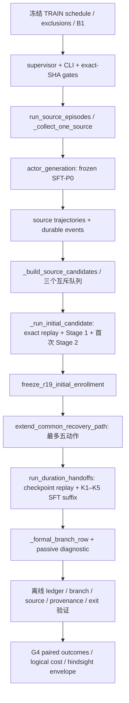

# R19 Implementation Onboarding

检查日期：2026-10-23 JST（证据核对时间 2026-10-22 23:10 UTC）。
角色：Implementation Engineer。范围：只读熟悉、静态接口审计，以及新增本报告。

## 1. 结论与证据分级

**当前状态：NOT READY FOR EXECUTION；等待 GPT-6.1 Sol 分配实现任务。**

用户提供的 `bf31f3d` 是真实故障版本，但当前 R19 worktree 已在修复分支
`codex/r19-source-contract-repair` 的 `da7d348`。原来的两个 source collector
错误已在该分支修正；随后独立 exact-SHA review 对该提交给出 **FAIL**，发现三个
尚未关闭的生产问题。G2 carry-forward PASS 只证明原 smoke 证据可继承，不能
解释为当前实现 PASS 或新启动许可。

本文标签：

- **CONFIRMED**：本轮读取的代码、实际文件/哈希，或注明出处的既有独立复现记录直接支持。
- **SUSPECTED**：生产接口之间存在具体静态矛盾；本轮未执行定向复现，需下一轮合成测试裁定。
- **NOT VERIFIED**：未执行、没有覆盖证据，或不能从现有材料推出的性质。

本轮没有运行 pytest、项目 CLI、模型加载/生成、ALFWorld 构造/reset/step、replay、
G3 preflight 或 G4 analyzer；没有修改代码、配置、测试、原始证据或 provenance；
没有 commit、push、checkout、merge、fetch、创建 worktree 或委派子代理。
仅用 Git/文件读取、标准库 JSON/哈希核对及 GitHub 只读接口，新增本 Markdown。

## 2. 实际仓库、SHA 与工作区

GitHub SHA 通过连接的 GitHub 接口直接按分支读取 commit 核对，未把旧的
`origin/*` 缓存当作远端实时证据。

| 对象 | 实际分支 | 本地 HEAD / 远端 SHA | 初始状态 |
|---|---|---|---|
| 本聊天起始 worktree（R18-C2） | `agent/codex-r18c2` | 本地 `e537f441010077123a307e9d50ea40cf8dad8547` | clean；未切换分支；该分支远端本轮未实时核对 |
| 用户指定 R19 原研究分支 | `codex/r19-recovery-duration-v1` | 本地 ref 与实时远端均为 `bf31f3da430ffc35bd17fc380e1752adce6d1467` | 当前没有 checkout 此分支的 worktree |
| 实际 R19 worktree | `codex/r19-source-contract-repair` | 本地与实时远端均为 `da7d348ffd3677d619dd31357e1e1e3cca28c9ec` | 初始 clean；本报告新增于此 worktree 根目录 |
| Research provenance | `main` | 本地与实时远端均为 `d54ebb7eec421f6e5c70565f895adfdbe6498ee2` | `INDEX.md` 已有修改，另有未跟踪目录；全部保留 |

worktree 清单还包含主开发 worktree、Antigravity/R18 review worktrees，以及
`ef2328f`、`51ec074`、`da7d348` 的临时 review checkout。未移动、删除或更新任何一个。
收尾复核期间，其他工作将 provenance 推进至
`a5f59f0a2b3c46bdb15e8f8deeb05f6a9b5a1b6d`，本地与实时远端再次匹配；前序
`68d7c88768b23892b5119152d6580e5ee956e4d5` 已上传 Luna readiness。原 `INDEX.md`
修改已随其他工作提交，四个旧 supervisor/review 未跟踪目录仍在。本轮没有执行这些提交。
R19 scientific 两分支 SHA 在收尾远端复核中保持不变。
R19 两笔后续提交为：

1. `51ec074cec6c2c2a7b1ecd64e0da33bc446a7e54`：source contract 修复及有界 restart。
2. `da7d348ffd3677d619dd31357e1e1e3cca28c9ec`：绑定真实 predecessor supervisor receipts。

以下代码行号均基于 `da7d348`；历史两项错误另明确使用 `bf31f3d` 行号。
报告不包含服务器绝对路径、凭据或原始模型/环境文本。

## 3. 已读材料与协议优先关系

已读 `AGENTS.md`、`PROJECT.md`、`PAPER_PROPOSAL.md`、`EXPERIMENT_PLAN.md`、
`IMPLEMENTATION_PHASES.md`、`reports/SPRINT_1_5_FINAL.md`；R19 protocol、机器配置、
B1 manifest/G2 amendment、G3 authorization、entrypoint repair authorization、source
contract amendment/restart authorization/unit-resolution event；指定四个脚本、duration
模块、四份 R19 测试文件及统计 fixture 相关实现；failure/cost audit 与后续 review/RECORD。

早期项目文档描述 selector 的长期研究目标和旧 Sprint 状态，不能作为现在开发 selector
的授权。R19 的 dated scope exception 只允许一次临时 recovery episode 内最多五个
环境动作，以及被动离线 stopping diagnostic。它不解冻 H4、历史 joint operator，
也不允许在线 reflection loop、训练或新环境。开发 seeds 1005/1009/1010/1022/1027
仍不得作为 held-out 证据。

G2 amendment 与后续 G3/restart authorization 必须按版本和具体 scope 合并理解：
早期 B1 manifest 的 smoke-only 是历史授权边界，G3 使用另行版本化授权；任何一个
`APPROVED_BY_USER` 字段都不能替代最新 exact-SHA review。**本轮用户明确只读，
因此不执行历史文件中的 restart、同步或自动 commit/push 指令。**

## 4. 架构与关键调用关系

### 4.1 启动与身份层

- `scripts/launch_r19_supervised.py::supervise` 用独立 child process 执行给定 argv，
  记录 cwd、解释器、允许记录的环境变量、run ID、命令哈希、日志、heartbeat 和真实
  `subprocess.returncode`。`preflight_only` 与 `live` 明确区分。
- `scripts/run_r19_recovery_duration.py::main` 是原 CLI；`pilot` 先经过
  `_pilot_gate_check`，再以 origin 检查导入真正的 `run_r19_experiment`。
- `run_live_experiment` 先验证 exact SHA/clean worktree、授权、G2 carry-forward、
  frozen hashes、runtime、模型/adapter/task 文件身份和 supervisor context。
  `preflight_only` 在构造 `LiveR19Runtime` 前返回。真实执行使用 common Git dir 的
  `RepositoryWriterLock`；event journal 与 unit registry 在运行输出目录中持久化。
- `load_and_validate_isolation` 要求 actor/recovery 两个独立模型对象；recovery 无
  adapter，actor 为原 SFT-P0 adapter，无 KV-cache 共享。只读 preflight PASS 不证明
  collector、handoff 或完整 G4 成功。

### 4.2 Source 与 prefix 层

- `run_source_episodes` 按冻结顺序逐个 claim `source_episode` unit，建立精确任务环境，
  调用 collector；collector 写完 trajectory/event 后 registry 才 complete。
- `_collect_one_source` 输入是 environment、schedule episode mapping、output path；
  reset 检查精确 task/split；最多 50 次 source decision，实际动作与失败 parser 都有记录。
- `actor_generation(cursor, component, identity)` 返回 **三元组**：
  `(generation_dict, decision_dict, generation_event_id)`。decision dict 包含
  `prompt/selection/parser_result/action/action_id/status/component`。
  `parse_p2_selection` 返回对象，但该对象在 producer 内转换为 dict。
- source row 的 `steps`、policy prompt/generation、action map、generation/transition
  IDs、source game/traj hashes 连接 raw ledger 与后续 CONTINUE；不能只信 summary。
- `_build_source_candidates` 使用 R8 cycle/navigation/midpoint/hash 语义，仅把最低
  remaining horizon 调整为 5；先 failure/success-control，再从剩余不同 episode 选 random。
  source outcome 只决定描述性 strata，不进入 recovery/SFT prompt 或 stopping detector。

### 4.3 Recovery、handoff 与分析层

- `_run_initial_candidate` 通过 `_replay_source_prefix` 恢复 source 状态；在同一任务上
  固定 Stage 1，执行 `execute_common_recovery_path(max_actions=1)`。
- `freeze_r19_initial_enrollment` 收集全部 initial attempts，记录不合格原因，冻结
  attempted/eligible cohort；首动作 terminal 或 parser failure 保留为 ineligible K1。
- `execute_frozen_r19_enrollment` 只延伸 eligible paths。`RecoveryCursor` 保存 task、
  seed、observation、**有序** valid actions、完整 public history 和已用动作数；
  `RecoveryPath` 保存 Stage 1、Stage 2 attempts、动作、checkpoints、stop reason。
- `run_duration_handoffs` 固定 suffix shuffle seed 19022，对每个 K 取公共路径 endpoint，
  从原 reset 重放 source actions 和 recovery actions，再由 SFT 继续。不得从某个已执行
  SFT suffix 分叉。同 endpoint 可复用 suffix，但必须显式链接 evidence 并各算 logical cost。
- `_formal_branch_row` 从源轨迹 decision index 起复用 CONTINUE suffix；不重新生成 comparator。
  `_run_frozen_pilot` 最后生成 passive stopping estimate 和 `branches.jsonl`。
- analyzer CLI 依次执行 `validate_event_ledger`、`validate_branch_evidence`、
  `validate_live_source_schedule`、`validate_live_execution_provenance`、
  `validate_live_exit_receipt`，再计算统计和报告。formal live G4 需要完整 bundle，
  synthetic 报告必须明确 `--allow-synthetic`，不得伪装为 live。

### 4.4 事件、状态恢复与双成本账

| 接口/事件 | 生产契约 |
|---|---|
| Source generation | `component=task_actor, operation=source_generation` |
| SFT suffix generation | `component=sft, operation=task_actor_generation`（现有 suffix 契约） |
| Recovery generation | `component=stage1/stage2`，Stage-2 attempt 编号；外层 scheduler 持久化 generation start/completion |
| 实际 reset/action | `environment_operation_started/completed`；payload reset 类型为 `environment_reset`；action 必须关联当时 Action-ID map |
| Scheduler recovery action | `environment_step_started/completed`，经 `r19_environment_operation_event_id` 关联实际操作；不重复计物理动作 |
| Cohort/branch evidence | `source_episode_completed`、`candidate_queues_frozen`、`prefix_attempt_completed`、`enrollment_frozen`、extension 和 duration-arm receipts |

`DurableEventJournal` 对 identity/payload/run context 做 hash chain，append 后 fsync；
registry/manifest 用 atomic replace。开始外部调用前记录 started；缺少 completed 就是
indeterminate，不能 blind rerun。`UnitRegistry.begin` 对旧 incomplete unit 会改变其
状态，因此**只读审计不能对原 registry 调用 begin**。当前 runner 对已完成 source 的
`REUSE_COMPLETED` 会 fail closed，不能假定存在完整自动 resume orchestration。

物理账只计真实 generation 和实际环境 operation 一次，包括 reset、replay、失败调用；
logical 账对每个正 K 各自完整计 Stage 1、该 K 请求的 Stage 2（含 invalid attempt）、
恢复动作和自己的 SFT suffix，不分摊 shared cost、不计 simulator restoration、不收取未来
K 的请求。`logical_policy_cost` 分 recovery-only/full-branch，各含 input/generated/total
tokens、model calls、environment actions；latency 是同步后的共享组件之和，不是独立部署测速。

## 5. 当前冻结科学协议

| 项目 | 冻结值/规则 |
|---|---|
| Baseline/model | `R19-B1`；Qwen3-8B snapshot `b968826d9c46dd6066d109eabc6255188de91218` |
| Actor adapter | frozen SFT-P0；directory SHA256 `6e403d85b150a74dfcc176f1f180ce4baf6fdacd922d2f96b3ceef0a21100f11` |
| 历史 R18 等价性 | `NOT_ESTABLISHED`；B1 是 prospective pinned baseline，不能据此重写历史 |
| 解码 | greedy、thinking disabled；Stage 1/Stage 2/SFT 上限 40/16/16 tokens |
| Prompt/handoff | Stage 1 仅一次；诊断/subgoal 不变；Stage 2 更新 public state/action map；K 不进 prompt；SFT history window=4；无 FACT/CARD 或 recovery reasoning overlay |
| Duration/horizon | K=1..5，按实际环境动作计数；总 horizon=50；候选 `H=50-p>=5`；handoff 剩余 `50-p-实际恢复动作数` |
| Failure semantics | Stage 1 invalid 仍请求一次 Stage 2，但不执行动作；later Stage 2 invalid 无修复/重试，非 terminal 时交还 SFT；执行 no-op 消耗一步，未调用 env 的 parser failure 不消耗动作 |
| Population | TRAIN development only；实际冻结 127 个唯一 game/trial；seed=`30000+schedule_index`；不因新 seed 改称新 task |
| Family counts | simple 30、two-object 0、clean 30、cool 30、heat 30、light 7；不可借用缺额 |
| Cohorts | candidate queues 至多 60/30/30；initial attempts 至多120；eligible failure/success/random=30/15/15，合计至多60；不得 quota transfer |
| Eligibility | 首次 recovery action 已执行且非 terminal、原 H>=5、exact replay；与后续成功或 subgoal 可满足性无关；freeze 后才延伸 |
| Main outcomes | binary terminal success（done 且 reward>0）；paired K2..5 vs K1、CONTINUE help/harm、logical cost、hindsight envelope |
| Statistics | discordant-pair exact two-sided binomial + 四个 contrast 的 Holm；97.5% CP win/loss proportions 合成保守 paired interval；零分母 NA；不能把五个 K 当独立样本 |
| Hindsight | `S_fixed=max_K mean R(K)`；`S_oracle=mean max_K R(K)`；差为本开发样本 common paths 的 hindsight headroom，不是可部署 controller 或总体上界 |
| Fixed-K tie break | success 最高，再 full-branch logical tokens 最少，再较小 K；报告每层 ties |
| Passive stopping | 仅 checkpoint 前 public action/observation + 原 subgoal；SATISFIED 才提前交还，否则到共同 stop/cap5；无新增模型调用；映射不精确只报 coverage |

R19 source selection 的训练重叠与历史 inventory 完整性不能由本次静态阅读重新证明；
不作 unseen/training-disjoint/general ALFWorld accuracy 声明。two-object=0 的既有
family audit 指向历史 SFT overlap 排除；这不是本轮扩大样本的理由。

本轮重新计算并匹配的冻结 SHA256：

| 文件 | SHA256 |
|---|---|
| `R19_PROTOCOL.md` | `7668d7fa5422ad6ad7d3affc72b2e573ec19aae53314198fc14b46dc74c9a3d9` |
| `configs/experiments/r19_recovery_duration_v1.json` | `3d7d1865c807d12276a8109b06c55da4e9182df0ca05a0b5463f8128dd03e122` |
| `r19_b1_baseline_manifest.json` | `d503f35ae913b137dfff091263bf29c38aa0ade2eea648dc45d7e6cf80da0973` |
| `r19_preflight_v3/source_schedule.json` | `0be460359fe43193e73f8cb55a8fb19fdba02ea70e3d0809ec5978fad21c8948` |
| `r19_preflight_v3/exclusion_manifest.json` | `70447bba1b2a944d52ab9b4041b2d6ff3d865f4f0abd55d655214c8060ff5367` |

## 6. 实际运行状态与失败证据

**CONFIRMED：** G2 PASS 是 implementation
`92aae1d9b230cc212c6ec4effc99aa468941e69d`、run
`33b5563d86d6491a821db224dd38ec3c` 的旧技术 smoke。B1 amendment 的 cap-safe layout
是每个 case 一个独立 K1 decision reference、一个生产 K1、两个生产 K3，总计六个
full arms。不是八个已完成 full branches，也不是在 `bf31f3d` 或 `da7d348` 新跑的 G2。

**CONFIRMED：** G3 run `3d1ccea7e97f4727abf8e216ac6ec498` 在 `bf31f3d` 实际启动，
authentic child exit=1；首个 source schedule index=0、seed=30000。该 unit 未完成，
不是 task-level failure。真实完成的一次 generation 为 267 input + 5 generated tokens；
一次 reset、零 environment actions、零 recovery attempts、零 eligible prefixes/branches，
无 incomplete external operation。unit incomplete 与 external operation indeterminate 是不同概念。

原 `execution_manifest=RUNNING`、registry=`in_progress` 是保留的失败现场；不能由此
声称进程仍运行或更改原始状态。原 empty branch ledger 不能支持 G4 efficacy 结论。

| 历史单位 | Generations | Environment operations（含 reset） |
|---|---:|---:|
| 失败 G2 replay predecessor | 0 | 19 |
| PASS G2 smoke | 176 | 322 |
| 早期 G3 import failure `a0de515…` | 0 | 0 |
| G3 source contract failure `3d1ccea7…` | 1 | 1 |
| **累计** | **177** | **342** |

累计 non-reset operations=330，resets=12；token 成本合计 112794 input、1026 generated、
113820 total。上述总账来自既有独立 cost audit；本轮另直接读取原 G3 四条 event 并重数，
没有运行 analyzer 或重做科学操作。

以下原现场文件本轮重哈希均与 restart authorization 完全相符：

| 文件 | SHA256 |
|---|---|
| `execution_events.jsonl` | `fde95fcd72f1c4ac6409fab7f2112654e145f6184fefec690cae58ad345f1cd7` |
| `execution_manifest.json` | `f5d3efa6c17abea3d944d7dea01099210d846eb8ed107057ec24502bbb51d2df` |
| `unit_registry.json` | `870923242ae585c66cbcffa554528ab3d92cf98fc4d87dee2c4d408f5f6ba800` |
| `branches.jsonl` | `e3b0c44298fc1c149afbf4c8996fb92427ae41e4649b934ca495991b7852b855` |

CONFIRMED：后续 restart 文件记录过“conditional one bounded restart”的历史用户采用，
但 exact-da7d348 review 为 FAIL，`positive_preflight_eligible=false`，
`launch_clearance_issued=false`。clean-process predecessor loader supplement 只通过 loader，
明确没有改变总 FAIL。没有证据表明该 repair SHA 已有成功 live source/G3/G4。
Luna readiness 为 NOT_READY_FOR_EXECUTION；该目录在检查开始时未跟踪，收尾已由
其他工作上传。新发布的 Sol independent audit 再次复现三个问题，保持 FAIL、无 launch
clearance，并排队后续实现/operator 任务；排队记录不证明任务已执行，也不解除本轮只读。

## 7. 已确认的原 source collector 两个错误

| ID | 历史证据 | 当前 repair 分支状况 |
|---|---|---|
| C1 — CONFIRMED | `bf31f3d:run_r19_experiment.py:1378` 返回 decision dict；`:1456` 却读 `parsed.selection_status`，后续也读 `.action/.action_id`；真实 traceback 确认 AttributeError | 当前 `:1765–1818` 保持 dict 返回；`:1940` 起 collector 用 `parsed["status"/"action"/"action_id"/"selection"]`；single-episode synthetic integration 既有 review 记录通过 |
| C2 — CONFIRMED | `bf31f3d:run_r19_experiment.py:1350` 无条件覆盖 operation=`task_actor_generation`；原 G3 completed event 也确为此值；source validator 要求 `source_generation` | 当前 `:1779–1787` 保留并检查 source operation，只让 suffix 维持旧 `task_actor_generation`；analyzer `:1279` 附近仍严格检查 source identity |

最小方向是 collector 消费既有 mapping、source producer 保留 source event identity；
不改变 parser、prompt、action selection、decoding 或模型。该方向已被现有修复实现，
下一轮不应重复重写。原事件保留旧 operation，不能事后“修正”为新标签。

## 8. 其他生产接口风险（代码证据）

### 8.1 既有 exact-SHA review 已复现的问题

**R19-SRC-01 — CONFIRMED，BLOCKING：restart comparator 在第二个 episode 再执行。**
`run_r19_experiment.py:1858–1869` 读取 consumed 状态并拒绝重复 index0，但 `:1905`
只检查 `restart_expected is not None and step_index == 0`。index1 的 step0 也进入
comparison 写入，`:1934` 拒绝已存在 sidecar。独立 review 在同一 runtime 连续两条
合成 source episode 后复现：第二条已付一次 reset/generation，随后 FileExistsError，
尚未执行第二条 action。本轮只静态确认代码，不重新复现。

最小建议：comparison block 精确限定 schedule index0 的首 decision，并使用一次性
生命周期状态；保留 duplicate index0 拒绝、mismatch-before-action stop、禁止覆盖 sidecar。

**R19-SRC-02 — CONFIRMED，MAJOR：standalone analyzer 成功路径 import 缺失。**
analyzer `:28` 只注入 `src`；`:490` comparator 才 `from scripts import run_r19_experiment`。
从仓库外 clean fresh process 执行到该路径，独立 review 已复现 ImportError。现有
in-process tests 先 import runner，掩盖根目录依赖。最小建议：采用现有 file-root bootstrap
和 origin verification，或把纯 snapshot helper 迁至可直接导入的 `src` 模块；由 Sol 选择
最小差异，不借此重构运行器。

**R19-SRC-03 — CONFIRMED，MAJOR：持久化 source trajectory hash 域不一致。**
runner `:2017` 先计算 digest，`:2018` 后写 `source_episode_completed`，`:2033` 才给 row
metadata 增加 `source_restart_comparison_sha256`。runner `:2590` 和 analyzer `:408`
的 canonical helper 都没有排除新字段。最终 JSONL/returned row 重新计算不再等于声明值；
review 记录了实际不等 digest。durable event 中的 earlier row 可以仍通过 event-only validator，
所以不能以某一个 validator PASS 宣称所有 artifact 一致。

最小建议：明确唯一 hash domain，在 hash/serialization 前放入 comparison reference，或
一致移到 hash 域外。要求 returned row、JSONL row、durable event trajectory 三方 canonical
digest 一致；不能修改原失败 evidence 或放宽现有 integrity 检查来掩盖差异。

### 8.2 本轮新增静态疑点，尚未执行复现

**S1 — SUSPECTED，HIGH：source prefix replay 的物理 receipt 缺 Action-ID。**
`run_r19_experiment.py:1630–1657` 的 `record_step(..., action_id=None)` 将入参原样写入
start/completion；`:2076–2083` 的 `_replay_source_prefix` 调用只传 `before`，未传 action ID。
analyzer `:350–353` 要求 `exact_map[str(payload.action_id)] == command`。因此任何 p>0 的
source replay 可能真实执行后才在 ledger 验证失败；branch source replay 同样复用该方法。
下一轮用真实 replay/record_step + 合成 env 验证；应绑定当时 map 的精确 ID，而非降低 validator
要求或改变 action order。原 G3 尚未到 replay，此项不是该 run 已发生的错误。

**S2 — SUSPECTED，HIGH：endpoint alias 的生产/验证契约冲突。**
`r19_duration.py:805–837` 按第一个实际测量的 endpoint 复用 suffix，`:862–870` 为每个 K
重新算自己的 logical cost。固定随机顺序为 `[2,5,4,1,3]`（本轮仅用标准库 shuffle 核对）。
但 analyzer `:961–969` 要求 alias 源 K 小于当前 K，且整个 `logical_cost` 和 `evidence_refs`
相等。若 action1 后 attempt2 invalid，K2 先测 suffix，K1 可 alias K2；K1 应只计两次
recovery generations，K2 计三次，正好触发两种契约冲突。later terminal/forced handoff 的
aliases 也需检查。最小建议：验证实际事件先后、相同 checkpoint/suffix 的因果复用；按各自
K 重建 recovery cost，保留同一 suffix cost，禁止 forward-event/cycle/conflicting aliases。
不能改 suffix 顺序来绕过冻结协议。

**S3 — SUSPECTED，HIGH：extension callback 动作编号相对新起点重置，影响 phase 账。**
`run_r19_experiment.py:1712–1718` 以 checkpoint1 作为新 callback 的 prefix；`:1687` 使用
`current.actions_consumed - prefix.actions_consumed + 1`，于是实际第2个 recovery action
的物理 identity 编成1。`:1503–1508` 与 `:1542` 按此编号区分 initial_attempt/path_extension，
可能把第一个 extension action 误记到 initial phase。scheduler `r19_duration.py:576` 起则使用
全路径 attempt2..5。总物理操作数可能仍正确，但 phase ceilings 与 ledger attribution 不可靠。
最小建议：保留原 common path action offset，使物理 receipt 与 scheduler action index 同步；
测试每条 eligible path 的 initial=1、extension<=4、无重复编号以及两层 receipt 一致。

**S4 — SUSPECTED，MEDIUM：单个 source validator 不足以证明 source raw 语义全绑定。**
analyzer `:1256–1318` 检查 source generation/transition 的 IDs、身份和 operation，但没有
像 suffix `:1114–1140` 那样把每个 source step 的原始 generation/prompt/parser action 与
实际 transition command、trajectory step 全量对应。event hash 证明字节未变化，不单独证明
producer 不会写入相互矛盾的合法结构。现有 `test_live_schedule_binding...` 使用手造简化
payload。建议用 producer-to-validator 成功集成加 mutation 测试裁定；是否扩展 validation scope
由 Sol 决定，不据此改写已有结果。

### 8.3 审查/授权接线风险

**CONFIRMED：** current restart loader `run_r19_experiment.py:837–858` 只接受四个 method
fingerprint overlay。修复上述既有问题会改变 `_collect_one_source` fingerprint；若修复 S1/S3，
还可能涉及未在旧四方法名单内的 replay/callback。不能仅改代码后沿用原 amendment、
review 或本地 gate，也不能自动更新 fingerprint 后自称通过独立审查。

**CONFIRMED：** unit-resolution JSONL 仍有 `review_status=PENDING_EXACT_SHA_REVIEW`；
已有 review 对 known-failed disposition 给出窄范围 PASS，但整体实现 FAIL。需要新的
append-only review/adjudication link 或审查过的版本化文件统一表达，不能改旧 registry。
当前 loader 又要求 resolution 文件恰好一行（`:816–818`），所以“追加即可”并非已验证的
实现方案，必须连同 schema/hash consumers 一起审查。

**NOT VERIFIED：** 本轮未重新 hash/load 大模型/adapter 文件、未重建 runtime、未验证全部
历史 exclusions 的完备性、未测试新的 gate/preflight，也没有 live 首 source 成功证据。

## 9. 已有测试覆盖与成功路径缺口

四份测试为 `test_r19_recovery_duration.py`、`test_r19_g3_authorization.py`、
`test_r19_entrypoint_repair.py`、`test_r19_source_contract.py`。静态阅读显示已有覆盖：

- horizon/K5 boundary、initial-vs-extension、eligibility freeze、invalid Stage 1/Stage 2、
  no-op/terminal、K-specific logical cost、public stopping 的 future-data mutation、统计 reference。
- deterministic queues、registry/lock、journal hash chain/未完成操作、auth tamper、supervisor exit、
  report-only 不触发 live boundary、旧 smoke replay 的 context reconstruction。
- repair 分支新测试使用真实 actor_generation/collector/parser/journal/registry/source validator，
  只替换 generator 和 environment；覆盖单 episode 内多步/50步、invalid parser、首 decision
  comparator match/mismatch、source remaining caps。

既有 independent review 记录 focused **93 passed**；full suite 为 **3 failed / 550 passed /
77 errors**，review 称 failure/error ID 集合与其 bf31 baseline 无新增。这是历史审查记录，
不是本轮重跑或整库全绿声明。93 passed 仍未发现三项 review blocker。

| 尚缺的成功路径 | 代码/测试证据与影响 |
|---|---|
| 同一 runtime 连续至少两条 source episode 的 restart lifecycle | `test_r19_source_contract.py::run_source` 只构建一个 task；多步测试是一个 episode 的长度，不是多个 episode；漏 R19-SRC-01 |
| 非空 comparator 的 standalone success path | `test_fresh_analyzer_cli_reaches_synthetic_event_validation` 用空 ledger，验证拒绝；未到 comparator；in-process import 掩盖 R19-SRC-02 |
| returned/JSONL/event 三份轨迹 canonical hash round trip | 首 episode 测试只断言 reference 存在/source validator PASS；漏 R19-SRC-03 |
| 实际 source replay receipt 贯穿 ledger validation | 旧 smoke replay 测试走另一方法；未证明 `_replay_source_prefix` p>0 receipt 有 Action-ID；对应 S1 |
| producer alias 输出直接交完整 branch validator | `test_same_suffix_alias_keeps_each_k_arms_own_cost` 只看 handoff 结果和成本，未把它交 analyzer；对应 S2 |
| initial + 延伸共享环境后的 phase 账 | helper callbacks 与 runtime callback/phase reservation 未形成同一个完整测试；对应 S3 |
| 真正 source→selector→attempt→freeze→K arms→validator→CLI report | `test_nonempty_source_fixture_reaches_synthetic_report_renderer` 手工创建 branch summary，直接 render；不是端到端 evidence validation |
| 全部冻结 127 source schedule 走完，再完成 G3/G4 | 没有真实成功证据；不能从 six-arm G2 推断 fresh source 接口或五个 K 全覆盖 |

## 10. 建议最小实现顺序与验收

以下是交给 Sol 的建议，不是本轮执行计划或新授权。

1. **先修既有三个 review finding**：一次性 comparator scope、standalone import、统一 hash domain；
   保留已修好的 mapping/source operation 契约。每项增加能复现实际接口问题的合成集成回归。
2. **先用合成边界裁定 S1–S4**，优先 S1–S3；不消耗真实 task、不加载模型、不 mock 被审查的
   producer/validator 主体。确认后由 Sol 确定最小 amendment 范围再修。
3. **更新审查材料而非冻结科学参数**：精确 diff、方法 fingerprint overlay、版本化 amendment/
   authorization 绑定、unit adjudication、成本 debit；旧 review/原始 bytes 不覆盖。
4. **形成真实接口成功闭环**后申请 replacement exact-SHA review；通过前不创建 passing gate 或启动。

建议验收集合：

- 两个不同 task 的连续 synthetic source episodes，index0 比较一次且动作前 PASS，index1 正常完成；
  重复 index0 在 reset/generation 之前拒绝；snapshot mismatch 保持一次 reset/一次 generation/
  零 action、unit incomplete，无重试。
- 真实 producer 返回的 row、JSONL round trip、event trajectory、registry receipt 的 canonical
  digest 相符；source event operation 严格为 source_generation；suffix 保持既有 operation。
- 在仓库外 cwd、移除 PYTHONPATH/PYTHONHOME/VIRTUAL_ENV 的新进程中，非空 comparator
  成功并验证 module origin；提供非空合成 CLI report 成功路径，明确 synthetic，不冒充 live。
- 合成 source 在 p>0 的 exact reset/replay 后，observation/有序 actions/history/seed/counter/map
  全一致；每条实际操作有正确 Action-ID；ledger、prefix、branch evidence validators 都通过。
- eligibility 冻结前无第二次 Stage-2；同一 common path checkpoint1..5；K prompt 隔离，
  原 p=45/K5 时 SFT cap=0；invalid later attempt、不合格 K1、terminal 和正向/反向 K alias
  都由 producer 输出直接交 analyzer 验证，成本逐 K 重建、禁止未来调用收费。
- 每个 eligible path 的物理动作 phase attribution 与 scheduler 相符；实际 receipt 只计一次，
  synthetic 调用计数与 ledger physical totals/phase counters 完全相等；继承177/342，source
  剩余额度8999/8999，不转移 phase budget。
- source/branch raw-output→parser→action-map→command→transition 的 mutation 应 fail closed；
  future reward/observation 不改变较早 stopping 判断；report-only 对模型/环境边界设阻断断言。
- focused tests 与有意义的完整合成闭环通过；full-suite 若仍有历史依赖错误，应列 exact IDs 与
  baseline 对比，不能以“无新增”替代生产集成验收。此后才进行独立 exact-SHA review。

真实执行的另行验收：Sol PASS、用户新的明确执行授权/正式 handoff、合法新 local gate、
同一固定解释器的 authentic production preflight PASS、零科学副作用，再允许约定的单个
successor。第一条真实 source 必须真正完成并通过 source validator；最终全部 source、
attempt/cohort、K arms、ledger、exit 与 G4 provenance 对齐。中途 mismatch/failure STOP，
保留现场，不自动重启；不能把该 first-source 验收扩展成额外试跑。

## 11. 必须由 Sol 审查和用户授权的操作

| 操作 | 所需边界 |
|---|---|
| 下一轮代码/测试实现 | 等待 Sol 指派明确范围；本轮不实施。常规合成修复验收可纳入该实现任务，无需推导出 live 权限 |
| 会影响执行、schema、hash domain、alias、phase 计账、fingerprint 或 gate 的修改 | Sol exact-SHA review；确认 scope/amendment 和 G2 carry-forward 是否仍有效。不能用旧四方法许可掩盖额外改动 |
| 失败 unit disposition / comparison 与重复物理操作 | Sol 审查可追溯的 append-only 裁定；任何重新 reset/generate 都需用户显式允许的 bounded successor，不能覆盖已完成操作 |
| 创建 passing local gate、真实 production preflight、正式 G3 successor | 当前 FAIL 先关闭；Sol PASS，正确授权/receipt/hash 绑定及用户正式执行 handoff；本轮明确禁止，旧历史授权不在本轮激活 |
| G2 affected smoke / replay 或任何额外真实检查 | 不自动重跑。当前记录明确 no G2 rerun；如代码触及原 carry-forward 范围，先由 Sol 和用户解决协议/授权冲突 |
| 改模型/adapter/runtime、prompt、K/horizon、task/seed/exclusion/quota、cap 或重新 campaign | 超出当前冻结 scope，必须先用户修改协议授权并经 Sol 审查；不能作为工程修复顺便实施 |
| G4 formal analysis / 对外科学结果 | 真实完整 bundle 验证及 authentic exit，Sol 审查解释边界；当前没有可用 G3 outcome，不发布 efficacy 结果 |
| commit/push/merge 或 provenance 上传 | 本轮用户禁止，均不执行；等待下一轮明确 scope。provenance 的自动同步约定不能覆盖本轮 no commit/no push |

训练、held-out/confirmation、DPO/ORPO、selector、memory、PPO/GRPO、新模型/环境、扩大 N/K、
自动 retry/第二 campaign 均不在本任务范围。禁止改历史 ledger/registry/manifest、将 incomplete
source 写成失败样本或把 synthetic 测试当 held-out evidence。

## 12. 主要 provenance 依据

以下目录均相对 research provenance repository。早期记录使用初始核对的 `d54ebb7`
固定链接；收尾新增记录使用再次核对的最新 remote main `a5f59f0` 固定链接。

- [G3 启动、preflight、真实失败及保全 RECORD](https://github.com/MikazukiMisaki/MLLM-Research-Provenance/blob/d54ebb7eec421f6e5c70565f895adfdbe6498ee2/agent-logs/2026-10-22T190221Z__CODEX__r19-g3-cli-preflight__bf31f3da/RECORD.md)
- [独立 failure audit RECORD](https://github.com/MikazukiMisaki/MLLM-Research-Provenance/blob/d54ebb7eec421f6e5c70565f895adfdbe6498ee2/agent-logs/2026-10-22T191409Z__ASTRA__r19-g3-failure-audit__3d1ccea7/RECORD.md)，同目录 `failure_audit.json`，SHA256 `8eb1248c1d863674119813ba1f90ba3ca6834bb1906cb2aa67acc6a4e087fe34`。
- [独立 physical-cost audit RECORD](https://github.com/MikazukiMisaki/MLLM-Research-Provenance/blob/d54ebb7eec421f6e5c70565f895adfdbe6498ee2/agent-logs/2026-10-22T192507Z__CODEX__r19-g3-physical-cost-audit__3d1ccea7/RECORD.md)，同目录 `cost_reconciliation.json`。
- [source-contract implementation checkpoint RECORD](https://github.com/MikazukiMisaki/MLLM-Research-Provenance/blob/d54ebb7eec421f6e5c70565f895adfdbe6498ee2/agent-logs/2026-10-22T224223Z__CODEX__r19-source-contract-restart__51ec074/RECORD.md)：其中“待 review”是历史 checkpoint，已被后续 FAIL 更新。
- [exact-da7d348 REVIEW](https://github.com/MikazukiMisaki/MLLM-Research-Provenance/blob/d54ebb7eec421f6e5c70565f895adfdbe6498ee2/agent-logs/2026-10-22T225858Z__ASTRA__r19-source-contract-exact-review__da7d348/REVIEW.md)，同目录 `independent_review.json`，SHA256 `8fcd731bcbfd01b2e89228e79f70834e15c57a5f3502e1a68f559355ab2e3c40`，结论 FAIL。
- [clean-process predecessor-loader supplement RECORD](https://github.com/MikazukiMisaki/MLLM-Research-Provenance/blob/d54ebb7eec421f6e5c70565f895adfdbe6498ee2/agent-logs/2026-10-22T230012Z__ASTRA__r19-da7d348-clean-loader-supplement__783927/RECORD.md)：仅 loader PASS，总 FAIL 不变。
- [Luna readiness](https://github.com/MikazukiMisaki/MLLM-Research-Provenance/blob/a5f59f0a2b3c46bdb15e8f8deeb05f6a9b5a1b6d/agent-logs/2026-10-22T230530Z__CODEX__r19-luna-readiness__d7c2ad/R19_LUNA_EXECUTION_READINESS.md)：NOT_READY_FOR_EXECUTION；由其他工作在本轮检查期间上传。
- [最新 Sol independent audit](https://github.com/MikazukiMisaki/MLLM-Research-Provenance/blob/a5f59f0a2b3c46bdb15e8f8deeb05f6a9b5a1b6d/agent-logs/2026-10-22T230825Z__SOL__r19-independent-audit-task-handoff__599954/INDEPENDENT_AUDIT.md)：同样确认三个 blocker、177/342 和 FAIL；fresh focused 93 passed，未运行科学执行。audit SHA256 `6fafc7d0776c988c6618d2a5420660b587e48d79ef56078db05e514568bb9a5a`。其任务调度记录仅作为后续交接背景，本轮不据文件自行开展实现。

交接状态：本报告为未提交文件；科学 HEAD 保持 `da7d348ffd3677d619dd31357e1e1e3cca28c9ec`。
没有新的科学成本或结果，等待 GPT-6.1 Sol 的实现任务。
