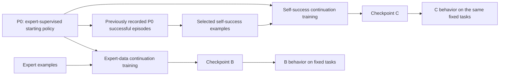

# What the SI-U1 comparison can identify

*Working explanatory note for independent review; not a new experiment or analysis.*

## Object of comparison

P0 is one previously expert-trained checkpoint. B is the observed result of one expert-data continuation from P0; C is the observed result of one continuation from P0 using actions selected from P0's successful episodes. Thus “self-improvement” here means a single supervised training continuation from an expert-trained starting policy with environment success feedback. It does not mean the agent learned without initial expert data, external feedback or human-specified selection rules.

For the fixed observed evaluation set, the paired contrast C−B describes how these two particular checkpoints behaved on the same 82 TRAIN tasks. Each continuation used one training seed, and these tasks are not certified held out or scene independent. Pairing makes the task-level outcomes directly comparable and records wins and losses. It does not randomly assign training data source or make the training data otherwise identical. It is a comparison of two constructed pipelines, not a controlled manipulation of an isolated data-source attribute.

The recorded family-level parent counts and supervised-token totals were matched. Nevertheless, B and C used different parent tasks and encountered different states and actions; their selected trajectories had different origins and selection processes, and their total input-token counts differed. Changes in these features occur together. A difference between the resulting checkpoints, if observed, would be compatible with several explanations. The present records do not identify what the exact same tasks, states, actions and training computation would have produced if only the abstract data-source label had changed.

The two training-data branches carry different tasks, states, actions, selection processes and input computation. The diagram is descriptive, not an estimated structural causal model; its arrows do not show that any particular feature caused success or failure.

## Claims and counterclaims

| Claim | Current support and boundary |
|---|---|
| C completed 67 of 82 and B completed 68 of 82 on the fixed recorded schedule; C had one fewer net success on these tasks. | A descriptive statement about the observed checkpoints and tasks, not a population ranking. |
| C is better, worse, equivalent, or demonstrably harmless compared with B or P0. | Not established by the original two prespecified paired comparisons and their uncertainty. A non-significant result is not evidence of equivalence. |
| The source of data alone caused the C−B difference. | Not identified: parent tasks, states, actions, selection and input computation changed with the pipeline. |
| The shared failure on eight two-object tasks is caused by insufficient data coverage. | A retrospective candidate explanation only; task difficulty, state coverage and behavior are alternative explanations. No causal mechanism was established. |
| The recovery study demonstrates self-training or an online adaptive controller. | No. R19 used the P0 actor and different selected development prefixes. The per-prefix oracle uses future measured outcomes and is not a runnable policy. |
| The method is the first to learn from an agent's own successful ALFWorld trajectories. | Not supported: earlier work used expert initialization and learned from successful trajectories. The contribution must be scoped to the actual comparison and evidence. |

The contrast can support a defensible empirical and methodological contribution: it makes the controlled and uncontrolled differences explicit, reports the predeclared inconclusive result and uncertainty, and provides an auditable account of failures and costs. Whether that is sufficient for a particular master's thesis depends on supervisor and institutional judgment. It does not prove a general new algorithm or a deployable effect.

## Evidence anchors and future boundary

The accepted outcome analysis is `FINAL_PILOT82_PAIRED_ANALYSIS_C2356.json`, SHA-256 `4a3ea016d4c06022980482ac9dbc58155a68bbe20fbc723a68ce49c7c345ea9b`; independent scientific acceptance is SHA-256 `6530145ac3ac579d00cdb57c28f3fa9bb07b27b990cfe0fba6e93b7fcca5eacd`. The methods and exposure limitations are documented in the [reviewed thesis](/home/lizening/research-notes/agent-logs/2026-10-30T015626Z__CODEX__si-thesis-methods-evidence__a88c/private_working_package/THESIS_WORKING_DRAFT.md) and its [private reproducibility appendix](/home/lizening/research-notes/agent-logs/2026-10-30T015626Z__CODEX__si-thesis-methods-evidence__a88c/private_working_package/appendices/si_u1/SI_U1_REPRODUCIBILITY_APPENDIX.md). Relevant prior work: Micheli and Fleuret, [Language Models are Few-Shot Butlers](https://aclanthology.org/2021.emnlp-main.734/). The retrospective diagnosis and R19 review are linked from the existing thesis evidence guide. Hashes identify records, not a fully reproducible archive.

Direct private-record references (access-controlled, not necessarily externally shareable): [accepted paired analysis](/home/lizening/research-notes/agent-logs/2026-10-29T225000Z__LUNA__si-u1-extraction-publication__062a/frozen_and_review/FINAL_PILOT82_PAIRED_ANALYSIS_C2356.json), [scientific acceptance](/home/lizening/research-notes/agent-logs/2026-10-29T230000Z__LUNA__si-u1-scientific-review-publication__c2356/astra/C2356_SCIENTIFIC_RESULT_INDEPENDENT_ACCEPTANCE.json), [R19 result review](/home/lizening/research-notes/agent-logs/2026-10-25T040304Z__SOL__r19-g4-independent-result-review__85cbb923_dffaf4/INDEPENDENT_G4_REVIEW.md), and [four-prerequisite review](/home/lizening/research-notes/agent-logs/2026-10-30T012341Z__CODEX__si-four-prerequisite-methods-review/FOUR_PREREQUISITE_DECISION.md). Their respective SHA-256 digests are `4a3ea016d4c06022980482ac9dbc58155a68bbe20fbc723a68ce49c7c345ea9b`, `6530145ac3ac579d00cdb57c28f3fa9bb07b27b990cfe0fba6e93b7fcca5eacd`, `e7941a530d60e97821bfa6931a2c142d31ef711c25019ba2ad502dd54066128e` and `e369fdabd899bf3c366d82d4f1e0d13e82f8440a8c1ac80e10cd586ced6158e8`.

The next evaluation must not be designed or initiated until independent task evidence, a testable claim, defensible precision and complete budget have all been established and independently reviewed under the existing plan. Unknown history and a lack of logged exposure must not be equated with proven nonexposure. No candidate task, treatment arm, training seed, allocation, new statistical threshold or new outcome was selected for this explanatory note.
