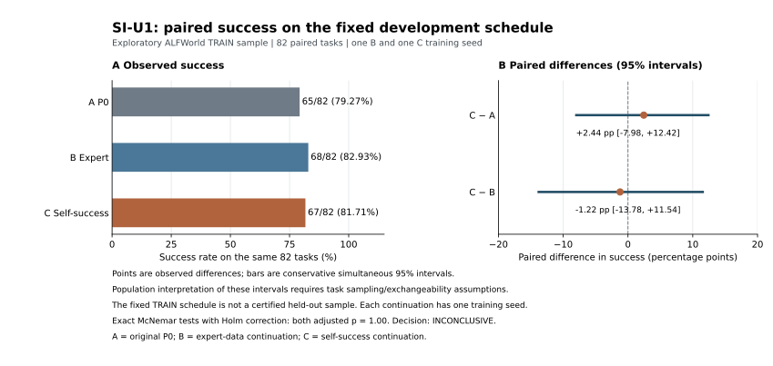

# Master’s Thesis — Working Draft

*Research draft, not a final submission. Citation style, broad literature review, institutional requirements, public-data permissions, and supervisor review remain pending.*

## Abstract

Language-model agents can collect trajectories while interacting with an environment, but the value of training on their own successful experience requires careful comparison with other sources of supervision. This thesis examines two specified supervised-continuation procedures from a common expert-trained Qwen3-8B policy in text-based ALFWorld. One continuation uses expert examples; the other uses selected actions from the starting policy's successful trajectories. The datasets are matched by task-family parent counts and supervised-token dose, but differ in tasks and states. On a fixed schedule of 82 TRAIN tasks, the unchanged policy, expert continuation and self-success continuation completed 65, 68 and 67 tasks, respectively. The paired self-success differences were +2.44 percentage points versus the unchanged policy and −1.22 points versus the expert continuation. Neither prespecified comparison met the positive decision rule; both Holm-adjusted exact p-values were 1.00. The result is inconclusive and does not isolate data source as a causal factor. All three policies failed the eight evaluated two-object tasks; retrospective evidence does not establish why. A separate exploratory recovery study retained 36 development prefixes after initial intervention and eligibility checks. The original-policy CONTINUE comparator reuses the recorded, identity- and replay-verified source suffix rather than a fresh rollout. CONTINUE and the best fixed recovery duration each succeeded on 30 prefixes, while a hindsight choice among the five measured durations succeeded on 32. The latter requires future outcome information and is not a deployable controller. The fixed TRAIN schedule, incomplete exposure and scene history, one training seed per continuation and selected recovery sample limit generalization. The contribution is a documented comparison, failure analysis and explicit evidence about the limits of the measured procedures, rather than a demonstrated self-improvement effect.

## 1. Introduction

Language-model agents can pursue a goal by repeatedly interpreting an observation, choosing an action, and incorporating the resulting feedback into subsequent decisions. In long-horizon tasks, however, success depends on a sequence of choices: an action that is syntactically valid may still be unhelpful, and an early mistake can change the later states the agent encounters. ALFWorld provides a test bed for such sequential interaction, including a text-based environment in which agents perform household tasks [1]. This thesis studies that text environment using an eight-billion-parameter Qwen3 model [2]. Its interest is practical and scientific: can an agent improve task completion by learning from experience it has itself generated, and what evidence is needed to distinguish improvement from variation or changes in the training data?

Supervised learning from expert demonstrations offers one starting point. Demonstrations give the policy examples of actions associated with task contexts, but those examples may cover a different distribution of states from the one induced by the learned agent. Sequential imitation-learning theory makes this dependence on the agent's own actions explicit [3]. One possible response is to collect the agent's interactions and use outcomes to construct additional training examples. When an environment supplies a reliable success signal, such data may reduce the need for additional expert annotation, but total cost also depends on interaction and verification; a successful episode does not by itself establish that every action in it is useful to imitate. Moreover, changes in the resulting policy may reflect the task and state distribution, the demonstrations' content, or the amount and format of training, as well as the source of the examples.

This direction is not new. In ALFWorld, Micheli and Fleuret [4] trained a language model on expert demonstrations and then iteratively trained it on its own successful trajectories using an action-modeling objective. Subsequent work has trained agents on self-generated reasoning-and-action trajectories with feedback-based reflection [5], and has used successful self-generated trajectories both as in-context examples and as data for fine-tuning [6]. Other work compares expert, learner-generated, and expert-corrected trajectory constructions in software-engineering agents [7], while studying mixtures that include expert data. Another study examines expert demonstrations augmented by experience-derived supervision [8], reporting a matched-step-budget comparison in its main text; its appendix distinguishes matched optimizer updates for one objective from matched epochs for another, and these controls do not establish equal total data-collection cost. Related text-game self-imitation has used past trajectories to adapt an action generator [10], while A³T used successful and failed agent trajectories for contrastive self-training [11]. A³T also evaluates on ALFWorld, but its contrastive objective and multiple rounds of trajectory collection and training differ from the one-round supervised continuation procedure studied here. Across these studies, the models, data-construction procedures, objectives, and evaluation settings vary. They demonstrate that self-generated training is established prior work; they do not by themselves determine the effect of the particular continuation-data pipelines studied here.

The primary study therefore asks a narrower empirical question about **two specified continuation procedures from a common starting policy**. The starting policy P0 is a Qwen3-8B checkpoint previously trained on expert demonstrations. From P0, one continuation is trained on expert examples and another on selected actions from P0's own successful trajectories. A third condition leaves P0 unchanged. The two continuation datasets are matched on training-parent counts by task family and on supervised-token dose, and the resulting policies are evaluated on the same fixed schedule. These controls make the resulting policy comparison interpretable within the chosen configuration. They do not isolate the source of experience as a single causal variable: expert and self-generated examples come from different tasks and states, and their input-token totals differ. In addition, successful-trajectory selection can omit difficult tasks and does not establish the optimality of the selected actions.

The study is exploratory. Its fixed evaluation set contains 82 distinct parent tasks from ALFWorld's TRAIN partition, rather than a certified held-out sample. Known task identities, parent directories and available file hashes were checked, but the complete history of exposure and the separation of scene layouts remain unresolved. Each continuation has one training seed and one final checkpoint. A paired comparison can describe how these particular checkpoints behave on the same tasks; it cannot establish the distribution of outcomes across independently trained checkpoints. Research on evaluating deep reinforcement-learning systems with few runs cautions against relying on point estimates alone [9]. For the present study, population-level interpretations also require explicit assumptions about task sampling and relatedness.

On this schedule, the unchanged policy, expert continuation and self-success continuation succeeded on 65, 68 and 67 of 82 tasks, respectively. The observed self-success-minus-P0 difference was +2.44 percentage points, and the self-success-minus-expert difference was −1.22 percentage points. Neither primary comparison met the predeclared positive decision rule: both Holm-adjusted exact McNemar p-values were 1.00, and the decision was **inconclusive**. These data do not establish a benefit of the self-success continuation, nor do they establish equivalence or absence of harm. A retrospective failure analysis describes the behavior of selected cases, but its outcome-dependent case selection does not make it an independent test of a causal explanation.

A separate exploratory study examines bounded recovery duration. At selected states from existing agent trajectories, it compares the recorded continuation of the original policy with handoffs after different numbers of recovery actions. Its purpose is to characterize the observed success and cost of the tested recovery paths, not to establish the effect of the continuation training study. On 36 eligible development prefixes, the best fixed tested recovery duration and the original continuation each succeeded on 30 cases. A hindsight choice among the five tested recovery durations succeeded on 32 cases, but it requires future outcome information and is not a deployable stopping policy. The two cases explaining its advantage over the best fixed duration were already successful under the original continuation. These observations motivate caution about recovery timing and cost; they do not establish an online recovery controller or a gain in overall self-improvement.

## 2. Research questions

**RQ1 — Continuation comparison.** For the frozen 82-task development schedule and the specified common P0, how does the task completion of the self-success continuation compare with (a) unchanged P0 and (b) the expert-data continuation? The estimand is the paired difference for the specified checkpoints and tasks. Because the data source is entangled with task and state distribution, this question is a comparison of the two constructed training pipelines, not an isolated causal test of data source.

**RQ2 — Descriptive failure evidence.** What patterns can be documented in the recorded trajectories for tasks on which either prespecified C−A or C−B comparison disagreed and for the evaluated two-object tasks? This question is descriptive: it examines recorded action/observation evidence and training-data coverage without treating retrospectively selected cases as a new randomized or confirmatory sample. Observed repetition or sparse category coverage can motivate hypotheses, but cannot by itself identify a cause of failure.

**RQ3 — Bounded recovery as a secondary study.** On the separate set of eligible development prefixes, how do the tested fixed recovery durations and the original-policy continuation compare in observed completion and recorded logical cost, and what does the hindsight envelope reveal about the tested paths? This question does not ask whether the continuation-trained policy improves, nor does it claim that the hindsight choices can be made online.

## 3. Claimed contributions and boundaries

1. **A nonrandomized, paired empirical comparison from a common starting point.** The thesis documents the construction of expert-data and self-success continuations with matched family-level parent counts and supervised-token dose, evaluates both alongside P0 on paired tasks, and reports the inconclusive decision under the predeclared rule with its uncertainty. The contribution is this particular comparison and its transparent constraints; it is not an invention of success-based self-training or evidence that data source alone caused a difference.
2. **An evidence-grounded descriptive failure analysis.** The thesis reports case-level observations, including the recorded 50-action termination pattern and limited training coverage of the two-object category, while distinguishing recorded facts from causal hypotheses. The analysis does not demonstrate why those tasks failed or that the observed patterns generalize beyond the selected cases.
3. **An exploratory account of recovery duration.** The separate recovery study reports fixed-duration outcomes, the original-policy baseline, logical cost and a hindsight-only envelope. It distinguishes an observed opportunity on measured paths from the unproven ability to choose a helpful duration at decision time.
4. **A reproducibility and interpretation record.** The study records its checkpoints, task identities, budgets, analysis and technical amendment, and states the limits of historical exposure, fixed TRAIN-task evaluation and one training seed per continuation. These records support scrutiny of the actual experiments; they do not certify unseen tasks, eliminate unobserved exposure or establish an efficacy claim.

## Experimental setting

This study investigates whether supervised continuation training on an agent's own successful experience improves task success relative to a fixed starting policy and a continuation trained on expert experience. We use Qwen3-8B [2] in ALFWorld [1], a text-based interactive task environment. The common starting policy, P0, is an expert-supervised checkpoint. The primary outcome is binary task completion under the frozen evaluation configuration, with at most 50 environment actions per episode. A separate exploratory study examines the consequences of varying the duration of a bounded recovery intervention. The studies address related but distinct questions; their outcome denominators and treatments are not interchangeable.

## Methods of the supervised continuation study

### Starting policy and experimental conditions

The study used a Qwen3-8B policy with a LoRA adapter [14]. The retained dataset and training records describe the common starting policy P0 as supervised imitation of successful hand-coded ALFWorld TRAIN expert trajectories. A historical source audit checked referenced file identities; attribution of the expert-generation procedure also relies on its contemporaneous report. The recorded balanced corpus contained 1,200 tasks and 20,967 action decisions, partitioned into 1,074 training tasks (18,828 decisions) and 126 offline-validation tasks (2,139 decisions). Historical training recorded two epochs and 2,354 optimizer updates; the checkpoint was selected by offline validation completion loss, not online task outcomes. The original base-model/tokenizer revision and a complete historical launch/runtime receipt were not established by the retained evidence. These limitations constrain reproducibility and historical exposure claims.

The unchanged starting policy is A. The expert-data continuation B and self-success continuation C were both independently initialized from the same P0 adapter with a fresh optimizer and frozen base; neither continuation was initialized from the other's trained checkpoint. B replays selected original expert training examples, while C imitates selected actions recorded on previously collected successful P0 trajectories. The comparison concerns these complete, differently distributed data-construction procedures: it does not identify experience source as an isolated causal factor.

### Continuation-data construction

For each condition the selected dataset contains 78 distinct parent directories and four distinct rendered-input examples per parent, for 312 examples per arm. The matching parent counts by task family were 34 simple placement, 24 clean, 10 cool, 8 heat and 2 two-object tasks; the light category contributed no selected update parent. The frozen construction rules specified the minimum-SHA-256 successful trial within each C parent, exclusion of all 95 recorded source parents from the eligible B pool, hash ordering of eligible B parents within family followed by a hash-selected trial, and the first four distinct rendered inputs under task-and-step hash ordering. A parent needed at least four different public-input states to be eligible. A same-input conflicting target was a specified fail-closed condition. C target actions came from the recorded source actor events, while B targets came from expert TRAIN rows. B and C used different parent tasks and states. The independent reconstruction verified the selected row references, 312 unique rendered inputs per arm, five supervised completion-plus-EOS tokens per example, and no cross-arm exact rendered-input match; it did not independently regenerate all candidate ranking decisions. Parent uniqueness and byte-level identity checks should not be read as proofs of scene or semantic independence.

### Optimization

Both updates continued the existing trainable P0 LoRA adapter, whose recorded configuration specifies rank 32, LoRA alpha 64, and dropout 0.05, with the same seed (42), optimizer settings and supervised-token dose. A fixed four-epoch order presented each example once per epoch; epoch orders were shuffled using seeds 42 through 45. The microbatch size was 1 with gradient accumulation over 16 microbatches, yielding 1,248 microbatches and 78 optimizer steps per arm; accumulation continued across epoch boundaries. The frozen optimizer configuration specified fused AdamW with a peak learning rate of 1×10⁻⁴, zero weight decay, gradient-norm clipping at 1, and a three-step linear warmup followed by cosine decay to 1×10⁻⁵ at step 78. The final step-78 checkpoint was retained without selecting on evaluation outcomes. Both runs recorded 6,240 supervised tokens, but the recorded input-token totals including completions differed: 661,620 for B and 695,872 for C. Matching the supervised tokens and optimizer steps therefore does not equalize input computation. Independent post-run reviews replayed the recorded sample order and all 78 learning rates; they do not independently reproduce GPU arithmetic or prove that no unrecorded external run existed.

### Evaluation and analysis

The action interface provided the goal, current public observation, up to four recent action/result transitions and an indexed list of admissible actions. The selected ID was parsed against the current map. A read-only audit of the hash-bound evaluation ledger found that all 5,001 completed generations recorded `do_sample=false`, thinking disabled, and a maximum of 16 generated tokens. The completed-generation counts were 1,713, 1,661 and 1,627 for A, B and C, respectively. This checks recorded invocation metadata and does not independently reproduce model execution or exclude unrecorded calls.

The fixed development schedule comprised 82 ALFWorld TRAIN task identities from 82 distinct parent directories. All three policies were evaluated on the same task order and corresponding reset seeds, once per condition, with a maximum of 50 environment actions per episode. The 246 recorded episodes completed. For SI-U1, success was the recorded terminal condition `done=true` with positive reward. The independent result review reconstructed this predicate from the final recorded environment state for all 246 episodes; termination alone and intermediate rewards were insufficient. The frozen protocol classified an action-selection failure as a policy failure; no such episode was recorded in this evaluation. Missing or infrastructure-failed episodes would have prevented a complete paired analysis instead of being silently omitted or replaced. The historical record does not establish that the selected tasks, scene layouts, or their semantic equivalents were never encountered previously; consequently this is a fixed TRAIN-development schedule, not a certified held-out test.

The two prespecified primary contrasts were the paired differences in success C−A and C−B. For each paired contrast, we used the McNemar framework for correlated binary outcomes [15] and computed a two-sided exact conditional binomial test on the discordant pairs, under an equal win/loss probability of 0.5; the two resulting p-values were adjusted using Holm's procedure [16] at family-wise α=0.05. Nominal conservative simultaneous 95% intervals for the differences were constructed from four two-sided 98.75% Clopper–Pearson intervals [17] for the win and loss proportions, combining the relevant lower and upper bounds. The simultaneous coverage follows from the four-component union-bound construction specified in the frozen analysis, rather than from a single Clopper–Pearson interval. These inference statements require appropriate task-level sampling/exchangeability assumptions and do not create a random population sample from a fixed schedule. The operational positive signal required both Holm-adjusted comparisons to meet the significance threshold, both observed gains to be at least ten percentage points, complete paired outcomes, and no observed C−A decline of ten percentage points or more in any task family. The protocol distinguished a five-percentage-point effect of scientific interest from the ten-percentage-point observed-gain threshold used for its exploratory operational signal. A decline of at least ten percentage points in either primary contrast, or in any family-level C−A comparison, triggered a warning; otherwise, failure to meet the positive rule was inconclusive. These were pilot decision rules, not evidence that the true effect exceeded either threshold. Family warnings were descriptive and were not powered subgroup safety tests. There was one training seed per continuation, so the experiment did not measure variation across independently trained checkpoints.

### Analysis amendment and provenance

After the evaluation, the original approved offline extraction invocation failed while checking tokenizer snapshot symlinks. It had streamed result-file bytes for hashes but failed before the subsequent full outcome parsing and statistics; the retained invocation did not generate or disclose success rates. A prior operational audit had parsed structure and terminal/reward consistency but did not aggregate treatment outcomes. A narrowly reviewed, post-run technical amendment allowed the existing production byte-binding procedure to verify the bytes reached through the frozen tokenizer snapshot symlinks under the existing production binding contract. The analysis plan, contrasts, thresholds, input outcomes and failed attempt remained unchanged; the successful analysis used the amended extractor. These statements concern the inspected records and do not establish that no other person or process had seen the results. The adapter weights and input datasets were not included in the remote evidence archive, and eleven large remote archive fragments have not undergone independent full-content redownload verification. Full reproducibility is therefore not asserted.

## Results of the self-improvement pilot

| Policy | Task successes | Success rate |
|---|---:|---:|
| A: fixed P0 | 65/82 | 79.27% |
| B: expert continuation | 68/82 | 82.93% |
| C: self-success continuation | 67/82 | 81.71% |

For C versus A, there were 3 paired wins, 1 paired loss, and 78 ties, for a difference of +2.44 percentage points. The unadjusted exact p value was 0.625, the Holm-adjusted p value was 1.00, and the nominal conservative simultaneous 95% interval was [−7.98, +12.42] percentage points. For C versus B, there were 3 wins, 4 losses, and 75 ties, for a difference of −1.22 percentage points; the unadjusted and Holm-adjusted p values were both 1.00, and the corresponding interval was [−13.78, +11.54] percentage points. The predeclared decision was inconclusive. The data do not establish an advantage of self-success continuation over either comparator, and the intervals do not support claims of equivalence or of harm smaller than five percentage points.

*Figure 1.* Observed success counts and the two paired contrasts on the fixed 82-task TRAIN schedule. The plotted intervals are nominal conservative simultaneous 95% intervals under the stated binomial assumptions; each continuation has one training seed. Population interpretation requires appropriate task-sampling or exchangeability assumptions. The two Holm-adjusted exact McNemar p-values are 1.00.

The formal evaluation completed all 246 episodes with no unresolved episode records. It consumed 5,001 model generations and 5,247 environment operations including resets. Training B and C together with evaluation used 6,063.34 allocated device-seconds; separate engineering probes used another 455.86 device-seconds. These are measured research costs, not latency estimates for a deployed policy.

## Descriptive failure analysis

A retrospective inspection covered all nine distinct tasks on which either primary paired comparison disagreed and all eight two-object tasks, a total of 17 tasks and 51 trajectories. This subset was selected using observed outcomes and is not a new randomized comparison. All 37 unsuccessful trajectories recorded done=true and reward zero on their 50th action. This record alone does not establish the mechanism of termination. The recorded 2,206 generated actions in the subset could be reconstructed under the frozen action mapping and matched the executed requests. No parser-to-request action mismatch was observed in these 2,206 recorded actions; this does not exclude unrecorded pipeline faults, establish that actions were appropriate, or show that other tasks were error-free.

None of A, B, or C completed any of the eight evaluated two-object tasks. Each continuation's training set contained only two distinct parent tasks and eight unique examples in that category. This limited coverage motivates a prospective hypothesis about training coverage, but the present data do not show that it caused the failures. Repeated command patterns appeared in some failing trajectories; because failed episodes were generally longer than successful ones and repetition may be legitimate, these observations do not establish a causal loop mechanism. On the 11 discordant paired comparisons, recorded model inputs, observation, and action-map hashes agreed immediately before the first different executed command; this does not establish equality of unrecorded environment state or that the divergence caused the ultimate outcome.

## Exploratory recovery-duration study

This separate exploratory study used the recorded P0 task actor and a bounded recovery intervention; it is not an evaluation of the SI-U1 continuation-trained policies. Reflexion uses feedback-derived verbal reflections across trials without updating model weights [12]. A recent ALFWorld audit examines action interfaces, recovery triggers and success construction in a Reflexion-style wrapper [13]. Its cross-trial wrapper and composite intervention differ from the common within-episode path studied here; its reported outcomes are not directly comparable to R19.

### Design and operational denominators

The task actor used the expert-supervised P0 adapter on Qwen3-8B. A separate recovery controller used the same underlying model without the P0 adapter. Under the frozen two-stage intervention, the controller first produced a diagnostic subgoal and then proposed recovery actions. For each candidate prefix, a single recovery path was constructed, with up to five recovery environment actions. K1–K5 designate a handoff after up to the corresponding number of recovery actions on this common path, subject to earlier terminal or validity stops; if the resulting state is nonterminal, the task actor then continues within the original 50-action horizon; terminal states end the episode. Exact reset and replay evidence was used to restore the relevant public state and action mapping. The no-intervention comparator, CONTINUE, is the original task actor's recorded source suffix after identity, prompt, horizon and replay checks; it is not a fresh no-recovery rollout.

The completed source schedule comprised 127 TRAIN episodes. These source episodes are not 127 recovery trials or 127 observations in the final K comparison. The candidate selection and initial recovery stage produced 39 attempted prefixes from 39 distinct recorded source episodes. Primary eligibility required an original prefix with at least five remaining actions before recovery, verified exact replay, an executed first recovery action, and a nonterminal resulting state. The primary cohort is therefore conditioned on what happened after the intervention began. Enrollment was frozen after these initial recovery attempts and before the common recovery paths were extended or their alternative SFT suffixes were evaluated. Of the 39 attempts, 36 prefixes met these rules: six from the failure stratum, 15 success controls and 15 random controls. The three remaining attempts were recorded as stage-one failures. The failure candidate queue exhausted after seven candidates; no quota transfer or backfill was performed. The frozen maximum of 120 initial attempts and target of up to 60 eligible prefixes were limits, not achieved sample sizes.

The branch file contains 39 attempt-level records and 183 K-labelled result records: each of the 36 eligible prefixes has five K records (180), and each of the three ineligible attempts has one (3). Eleven eligible K records are explicitly derived/aliased identities. These are result labels rather than 183 independent observations or necessarily 183 independent executions. The primary denominator for the four prespecified duration contrasts (K2–K5 versus K1) is 36 eligible prefixes, with results paired on the same prefix across the five K conditions; no two-object-task prefix was eligible. This selected, control-heavy development set is not a held-out population sample.

### Analysis and observed outcomes

An offline G4 analysis used the retained genuine G3 source and branch records. The prespecified primary duration comparisons were K2–K5 versus K1, using two-sided exact tests on discordant pairs with Holm adjustment across four comparisons. On 36 eligible prefixes, CONTINUE and K1 through K5 succeeded on 30, 29, 30, 28, 25 and 24 prefixes respectively. K2 was the best fixed tested positive duration on this same sample. Relative to CONTINUE, K2 succeeded where CONTINUE failed in two cases and failed where CONTINUE succeeded in two; hence both reached 30/36 despite different outcomes. Its mean logical full-branch token cost was 9,854.25 compared with 7,470.22 for CONTINUE, about 31.9% higher on this measure. The relevant K2-versus-K1 paired comparison had two wins, one loss and 33 ties, with Holm-adjusted p=1.00. These observations neither establish that K2 is optimal nor that the duration intervention improves net task success.

The hindsight envelope selected, separately for each prefix, the best observed success among the five measured K outcomes. It was 32/36, versus 30/36 for the best fixed K, a difference of 2/36 or 5.56 percentage points. Both the fixed choice and envelope were selected and assessed on this same development sample, and the envelope uses future outcomes unavailable to a live controller. The two extra envelope successes over K2 were already successes under CONTINUE; they are not two extra rescues over the no-intervention comparator. An offline public-state stopping diagnostic had a supported exact branch mapping for seven prefixes, all seven successful, and classified the remaining 29 as unsupported or ambiguous, coverage-only cases; the 7/7 conditional count is not a full-cohort controller estimate. No learned selector or prospective adaptive stopping policy was evaluated.

### Costs and interpretation

The genuine G3 successor used 4,965 model generations and 7,607 environment operations including 334 resets. Including earlier charged work, the R19 campaign ledger was 5,142 generations and 7,949 reset-inclusive environment operations. These are physical research expenditures, distinct from the per-policy logical token comparison above. G4 was a separate offline analysis and added no model generations or environment operations. No training or held-out task execution occurred in this study.

The results are consistent with variation in the best recorded handoff duration across some observed states; they do not demonstrate a deployable stopping rule, a causal gain over CONTINUE, a population bound, or a self-improvement effect. The control-heavy sample, six failure-stratum prefixes, absent two-object category and within-sample selection constrain generalization. The scientific takeaway is an exploratory hindsight opportunity, alongside a measured cost and the possibility of both rescue and harm.

## Discussion and limitations

The principal contribution of the pilot is a nonrandomized, paired comparison of two continuation-data procedures from a common checkpoint, with documented continuation-training dose, measured run costs, case-level diagnostics, and an explicit inconclusive outcome. It does not demonstrate autonomous improvement or isolate data source from task and state distribution. Nor does the recovery study demonstrate a useful adaptive controller. The results can inform hypotheses about data coverage, trajectory quality, and intervention costs, but they do not justify selecting a mechanism on these same outcomes and then treating it as independently validated.

The comparison has three distinct levels of interpretation: the observed outcomes of these fixed checkpoints, the expected performance of complete continuation procedures, and an isolated causal effect of experience source. For the complete pipeline, differences in selected tasks and visited states may themselves be part of its operation and mechanism, rather than automatically being nuisance variables to remove. The present data cannot identify the effect of source independently of those accompanying differences; more precise estimates for the same two checkpoints would not by themselves resolve that question. Extending a claim to a training procedure also requires evidence of variation across training runs, which the single B and C seeds do not provide.

Sharing P0 across conditions does not establish that unknown pretraining familiarity cancels from the comparison: its interaction with each continuation procedure is not identified. Conversely, unknown exposure is not evidence that a particular task was contaminated. It limits claims about unseen-task generalization or newly acquired capability while leaving the recorded fixed-schedule outcomes interpretable within their stated scope.

The evaluation schedule is a fixed subset of TRAIN; historical exposure and layout separation remain incompletely known. There is one trained seed per continuation, and subgroup counts are small. The original frozen extraction tool failed after evaluation because its tokenizer symlink interface did not match the environment. It had already read result-file bytes for hashing but did not complete result parsing or statistics. An independently reviewed technical amendment corrected this offline extractor; the original analysis plan, thresholds, data, and failure receipts were retained. No claim is made that no person or process had previously seen the results. For remote provenance, eleven large raw archive fragments have matching reported remote Git blob identities, but the original connector outputs were not separately retained and the fragments have not undergone independent full-content redownload verification.

At present, the four prerequisites for a new evaluation have not been established and independently reviewed: evidence of an independent task source, a testable hypothesis, defensible statistical precision, and a complete resource budget. No new evaluation will be designed or initiated until all four prerequisites have passed that review. Only then may a prospective protocol be prepared to freeze the estimand, task and training-seed dependence, primary contrasts, decision thresholds, multiplicity, missing-outcome rules, exposure controls, and execution budget before any new outcome collection or inspection. The retrospective two-object coverage observation remains a hypothesis and does not authorize a new evaluation. If the prerequisites cannot be established in the current feasibility phase, thesis development will proceed from the completed descriptive and exploratory evidence, with unresolved conditions recorded explicitly.

## Conclusion

This thesis investigated whether a supervised continuation on an agent's own successful trajectories improved task completion relative to an unchanged common starting policy and an expert-data continuation. For the two specified checkpoints and 82 fixed TRAIN tasks, the predeclared paired analysis was inconclusive. It does not establish that self-success continuation improves task completion, that it is equivalent to the comparators, or that it cannot cause harm. The conditions share a starting policy and match specified aspects of training dose, but training data source also changes which tasks, states and actions are presented. Their comparison therefore describes whole data-construction pipelines and does not identify an isolated effect of self-generated data.

The retrospective analysis documented failure patterns and sparse representation of two-object tasks in the continuation data. These observations help define questions, but do not prove that coverage caused the failures. In particular, repeated actions can be legitimate, and failure trajectories provide more opportunities to observe repetition than shorter successful ones. The diagnostic subset was selected using observed outcomes; it is not an independent confirmatory sample.

The separate recovery-duration study shows that outcomes can vary across measured handoff points on the selected development prefixes. The best fixed K and the hindsight envelope were both chosen on the same sample. The two successes that distinguish the envelope from the best fixed duration were already successes under the original CONTINUE suffix. No prospective adaptive controller or improvement to a continuation-trained policy was evaluated, and the results do not demonstrate a deployable net benefit over the original policy. Logical branch costs and the physical research cost are different measures and are reported separately.

Several limitations constrain what follows from these studies: the evaluation tasks are a fixed subset of TRAIN, historical task and scene exposure is incomplete, each continuation has one training seed, and the recovery cohort is selected after the intervention begins. The retained artifacts support audit of the recorded studies but do not establish complete rerunnability or a full history of unrecorded work. The research also builds on earlier success-conditioned self-training rather than introducing that general idea.

The four prerequisites for a new evaluation—an independent task source, a testable claim, defensible precision and a complete budget—are not currently established. A new evaluation will neither be designed nor initiated before all four are established and independently reviewed. In the meantime, read-only evidence work can continue, and the thesis can present the existing comparison and exploratory recovery results with their uncertainty and limits. Whether this scope satisfies the master's degree requirements remains a question for the supervisor and institution.

## Working appendix: evidence and confidentiality

Additional statistical and provenance materials are maintained separately under controlled access. This advisor discussion copy includes the aggregate figure and evidence note, but not underlying model weights, task data or a complete runtime environment.

The SI-U1 fixed-schedule analysis and its independent scientific acceptance are identified in the private research record by SHA-256 `4a3ea016d4c06022980482ac9dbc58155a68bbe20fbc723a68ce49c7c345ea9b` and `6530145ac3ac579d00cdb57c28f3fa9bb07b27b990cfe0fba6e93b7fcca5eacd`, respectively. The separate R19 independent results review has SHA-256 `e7941a530d60e97821bfa6931a2c142d31ef711c25019ba2ad502dd54066128e`. These hashes identify the cited research records, not the complete input data or a new replication.

A private evidence map connects the frozen plans, data lineage, actual run and correction records to these summaries. Source task identifiers, prompts and trajectories require controlled access. A local archive custody audit checked 32 archived members against local sources, while eleven large remote fragments have only had Git object metadata checked, not remote full-content rehashing. Model weights and input datasets are not contained in the archive, so full rerunnability has not been established. Before external submission, the evidence appendix, permissions, redaction and institution-specific citation style require review.

## References

[1] M. Shridhar et al., “ALFWorld: Aligning Text and Embodied Environments for Interactive Learning,” ICLR 2021, arXiv:2010.03768v2. https://arxiv.org/abs/2010.03768

[2] A. Yang et al., “Qwen3 Technical Report,” arXiv:2505.09388, 2025. https://arxiv.org/abs/2505.09388

[3] S. Ross, G. Gordon and D. Bagnell, “A Reduction of Imitation Learning and Structured Prediction to No-Regret Online Learning,” AISTATS 2011. https://proceedings.mlr.press/v15/ross11a.html

[4] V. Micheli and F. Fleuret, “Language Models are Few-Shot Butlers,” EMNLP 2021. https://aclanthology.org/2021.emnlp-main.734/

[5] Z.-Y. Dou et al., “Re-ReST: Reflection-Reinforced Self-Training for Language Agents,” EMNLP 2024. https://aclanthology.org/2024.emnlp-main.861/

[6] V. Sarukkai, Z. Xie and K. Fatahalian, “Self-Generated In-Context Examples Improve LLM Agents for Sequential Decision-Making Tasks,” NeurIPS 2025. https://papers.nips.cc/paper_files/paper/2025/hash/5d1f02132ef51602adf07000ca5b6138-Abstract-Conference.html

[7] N. Lauffer et al., “Imitation Learning for Multi-turn LM Agents via On-policy Expert Corrections,” arXiv:2512.14895v1, 2025. https://arxiv.org/abs/2512.14895v1

[8] K. Zhang et al., “Agent Learning via Early Experience,” ICML 2026, PMLR 306:154443–154475. https://proceedings.mlr.press/v306/zhang26m.html

[9] R. Agarwal et al., “Deep Reinforcement Learning at the Edge of the Statistical Precipice,” NeurIPS 2021. https://proceedings.neurips.cc/paper/2021/hash/f514cec81cb148559cf475e7426eed5e-Abstract.html

[10] Z. Shi, Y. Xu, M. Fang and L. Chen, “Self-imitation Learning for Action Generation in Text-based Games,” EACL 2023. https://aclanthology.org/2023.eacl-main.50/

[11] Z. Yang et al., “ReAct Meets ActRe: Autonomous Annotation of Agent Trajectories for Contrastive Self-Training,” COLM 2024. https://openreview.net/pdf?id=0VLBwQGWpA

[12] N. Shinn et al., “Reflexion: Language Agents with Verbal Reinforcement Learning,” NeurIPS 2023. https://proceedings.neurips.cc/paper_files/paper/2023/hash/1b44b878bb782e6954cd888628510e90-Abstract-Conference.html

[13] N. Ballal and B. P. V R, “Grounding First: Auditing a Structured Recovery Wrapper for Local Open-Weight Reflexion Agents,” REALM 2026. https://aclanthology.org/2026.realm-1.52/

[14] E. J. Hu et al., “LoRA: Low-Rank Adaptation of Large Language Models,” ICLR 2022. https://openreview.net/pdf?id=nZeVKeeFYf9

[15] Q. McNemar, “Note on the Sampling Error of the Difference Between Correlated Proportions or Percentages,” Psychometrika 12:153–157, 1947. https://doi.org/10.1007/BF02295996

[16] S. Holm, “A Simple Sequentially Rejective Multiple Test Procedure,” Scandinavian Journal of Statistics 6:65–70, 1979. https://www.jstor.org/stable/4615733

[17] C. J. Clopper and E. S. Pearson, “The Use of Confidence or Fiducial Limits Illustrated in the Case of the Binomial,” Biometrika 26:404–413, 1934. https://doi.org/10.1093/biomet/26.4.404
